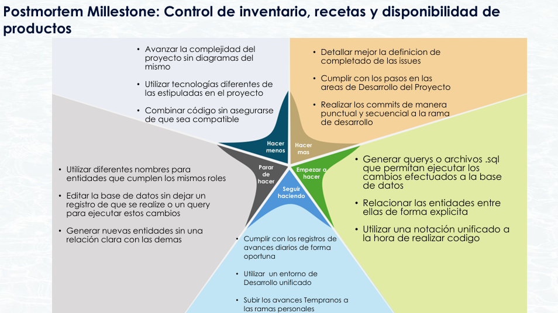

# Postmortem · Milestone Control de inventario, recetas y disponibilidad de productos

> 

## 1. Resumen

El milestone "Control de inventario, recetas y disponibilidad de productos" estuvo enfocado en fortalecer la forma en que GastroFlow administra la información relacionada con los ingredientes, las recetas y la disponibilidad de los productos ofrecidos por el restaurante. Este trabajo implicó realizar cambios sobre la estructura de la base de datos y sobre los componentes del sistema que utilizan esa información.

Durante el desarrollo se hizo evidente la importancia de mantener una relación clara entre las entidades y de conservar una estructura coherente entre la base de datos y el código de la aplicación. También se identificó que los cambios en el modelo de datos no deben tratarse como modificaciones aisladas: deben quedar registrados y acompañados de los archivos o consultas necesarios para que los demás integrantes puedan reproducirlos en sus entornos.

El milestone permitió reconocer prácticas que facilitaron el trabajo, como registrar los avances, utilizar un entorno de desarrollo compartido y subir los cambios oportunamente a las ramas personales. Al mismo tiempo, dejó oportunidades de mejora relacionadas con la definición de las historias, la documentación de la arquitectura y la coordinación de los cambios antes de integrarlos.

En general, la experiencia permitió identificar que la calidad del sistema no depende únicamente de que las funcionalidades estén implementadas, sino también de que los datos, las entidades, los diagramas y los cambios realizados mantengan una organización consistente.

## 2. Evaluación del producto y la calidad

El trabajo realizado durante el milestone permitió avanzar en la organización de los elementos relacionados con el inventario, las recetas y la disponibilidad de los productos. Estos componentes dependen de que la información de ingredientes y sus relaciones esté definida de manera clara, ya que cualquier inconsistencia en el modelo de datos puede afectar las consultas y los procesos que utilizan esa información.

Uno de los aprendizajes principales fue la necesidad de acompañar los cambios en la base de datos con un registro claro de lo que se modifica. Cuando se realizan ajustes directamente sobre la estructura sin dejar una consulta o un archivo SQL que los reproduzca, resulta más difícil mantener sincronizados los entornos de los integrantes y conocer el historial de las modificaciones.

También se identificó la importancia de utilizar nombres consistentes para las entidades y de definir explícitamente sus relaciones. Crear entidades nuevas sin establecer cómo se conectan con las existentes puede generar duplicidad de conceptos y dificultar la comprensión del modelo.

Por otra parte, el uso de diagramas y de una notación común ayuda a comprender la estructura antes de realizar cambios. Esto permite que el equipo tenga una referencia compartida y reduce el riesgo de implementar soluciones que no sean compatibles entre sí.

## 3. Organización del desarrollo y validación

La experiencia del milestone mostró que los cambios de base de datos y de código necesitan un proceso de desarrollo ordenado para que puedan integrarse correctamente. No es suficiente con que una modificación funcione en el entorno de quien la desarrolla; también debe ser comprensible, reproducible y compatible con el trabajo del resto del equipo.

Entre los aspectos que se deben fortalecer está la preparación de consultas o archivos SQL para ejecutar los cambios sobre la base de datos. Estos archivos permiten dejar evidencia de las modificaciones y facilitan que todos los integrantes trabajen con una estructura equivalente.

También es importante mantener una relación explícita entre las entidades y utilizar una misma notación al elaborar diagramas y código. De esta manera, el modelo de datos puede entenderse con mayor facilidad y se reducen las diferencias entre la representación del sistema y su implementación.

En cuanto al flujo de trabajo, realizar commits pequeños, frecuentes y asociados a la rama correspondiente facilita revisar los cambios y detectar incompatibilidades antes de integrarlos. La definición de terminado de cada historia también debe ser más precisa, de modo que todos tengan claro qué se debe implementar, documentar y comprobar antes de cerrarla.

## 4. Evaluación del trabajo en equipo

La retrospectiva permitió identificar prácticas del equipo que conviene mantener y otras que necesitan mayor atención durante los siguientes milestones.

**Comunicación y seguimiento.** Registrar los avances diarios de manera oportuna facilita que los integrantes conozcan el estado del trabajo, identifiquen bloqueos y coordinen las actividades que dependen de otros cambios. Mantener este registro ayuda a evitar que la información sobre el progreso quede únicamente en conversaciones informales.

**Desarrollo e integración.** Subir los avances tempranamente a las ramas personales permite que el trabajo esté disponible para revisión y reduce el riesgo de acumular demasiados cambios antes de integrarlos. También es necesario evitar combinar código que todavía no se ha comprobado como compatible con el resto del proyecto.

**Planeación y definición de historias.** Las issues deben describir con mayor precisión qué significa completar una actividad. Una definición clara de terminado permite que el equipo comparta los mismos criterios para revisar y aceptar los resultados.

**Diseño y documentación.** La elaboración de diagramas antes o durante los cambios ayuda a comprender las relaciones entre los elementos del sistema. Mantener una notación unificada y nombres consistentes facilita la comunicación y evita interpretaciones diferentes del modelo.

**Entorno de desarrollo.** Trabajar con un entorno unificado permite reducir diferencias de configuración entre los integrantes y facilita reproducir los problemas que aparecen durante el desarrollo.

## 5. Mejoras propuestas y evolución del proyecto

A partir de las situaciones identificadas, el equipo puede fortalecer su proceso de trabajo mediante acciones concretas para los siguientes milestones.

En primer lugar, se debe mejorar la definición de las historias de usuario, especialmente sus criterios de aceptación y la descripción de lo que se considera terminado. Esto permitirá estimar mejor el trabajo y reducir dudas durante la implementación.

También es necesario seguir los pasos acordados para las actividades de desarrollo, evitando realizar cambios aislados que no queden registrados. En el caso de la base de datos, cada modificación debe estar acompañada por su consulta o archivo SQL correspondiente, de manera que pueda reproducirse y revisarse.

Otro aspecto importante es mantener una relación explícita entre las entidades y utilizar nombres y convenciones comunes en el código y los diagramas. Antes de incorporar nuevas entidades o modificar las existentes, se debe revisar cómo encajan dentro del modelo general.

Finalmente, el equipo debe mantener los registros diarios, utilizar el entorno de desarrollo unificado y realizar commits frecuentes y ordenados en las ramas personales. Estas prácticas facilitan la trazabilidad, la revisión y la integración del trabajo.

**El principal aprendizaje del milestone fue que el control del inventario, las recetas y la disponibilidad de los productos requiere no solo implementar funcionalidades, sino también mantener un modelo de datos coherente, documentar los cambios y coordinar su integración.**

## 6. Diagrama de estrella de mar

El diagrama de estrella de mar permitió reunir las experiencias del equipo durante el milestone e identificar qué prácticas conviene mantener, cuáles deben reforzarse y qué comportamientos es necesario reducir o dejar de realizar.

La retrospectiva se organizó en cinco categorías: seguir haciendo, hacer más, empezar a hacer, hacer menos y parar de hacer. A continuación se explican las observaciones incluidas en el diagrama.

### Seguir haciendo

| Frase | Ejemplo y justificación |
| --- | --- |
| Cumplir con los registros de avances diarios de forma oportuna | Mantener los registros al día permite conocer el progreso de cada integrante, identificar bloqueos y facilitar la coordinación del trabajo. |
| Utilizar un entorno de desarrollo unificado | Trabajar con una configuración compartida reduce las diferencias entre los entornos de los integrantes y facilita reproducir errores y validar cambios. |
| Subir los avances tempranamente a las ramas personales | Publicar los cambios con frecuencia permite mantener el trabajo disponible para revisión, facilita la colaboración y evita acumular modificaciones difíciles de integrar. |

### Hacer más

| Frase | Ejemplo y justificación |
| --- | --- |
| Detallar mejor la definición de terminado de las issues | Especificar qué entregables, validaciones y evidencias se esperan permite que todos los integrantes comprendan cuándo una historia puede considerarse completa. |
| Cumplir con los pasos en las áreas de desarrollo del proyecto | Seguir el proceso acordado para implementar, revisar, probar e integrar cambios ayuda a mantener la organización y evita omitir actividades importantes. |
| Realizar los commits de manera puntual y secuencial en la rama de desarrollo | Hacer commits pequeños y frecuentes facilita identificar qué cambio se realizó, relacionarlo con su issue y revisar posibles errores durante la integración. |

### Empezar a hacer

| Frase | Ejemplo y justificación |
| --- | --- |
| Generar consultas o archivos SQL que permitan ejecutar los cambios efectuados a la base de datos | Registrar las modificaciones mediante scripts permite reproducir los cambios en los diferentes entornos y conservar evidencia de cómo evoluciona la estructura de la base de datos. |
| Relacionar las entidades entre ellas de forma explícita | Definir claramente las relaciones evita crear elementos aislados y facilita comprender cómo se conectan los datos dentro del sistema. |
| Utilizar una notación unificada a la hora de realizar código | Mantener convenciones comunes para nombres, estructura y representación de los elementos facilita la lectura y reduce diferencias entre las implementaciones de los integrantes. |

### Hacer menos

| Frase | Ejemplo y justificación |
| --- | --- |
| Avanzar la complejidad del proyecto sin diagramas del mismo | Reducir los cambios de diseño realizados sin una representación previa ayuda a que el equipo comprenda la estructura y las relaciones antes de implementar nuevas soluciones. |
| Utilizar tecnologías diferentes de las estipuladas en el proyecto | Evitar incorporar herramientas o tecnologías no acordadas disminuye los problemas de compatibilidad y mantiene el desarrollo alineado con las decisiones del equipo. |
| Combinar código sin asegurarse de que sea compatible | Revisar los cambios antes de integrarlos reduce conflictos, errores de compilación y comportamientos inesperados entre componentes. |

### Parar de hacer

| Frase | Ejemplo y justificación |
| --- | --- |
| Utilizar diferentes nombres para entidades que cumplen los mismos roles | Mantener nombres consistentes evita duplicar conceptos y facilita reconocer cuándo dos elementos representan la misma responsabilidad dentro del sistema. |
| Editar la base de datos sin dejar un registro de que se realice un cambio o una query para ejecutar estos cambios | Dejar de modificar la estructura sin registrar el procedimiento evita que los entornos de los integrantes queden diferentes y permite repetir las modificaciones de forma controlada. |
| Generar nuevas entidades sin una relación clara con las demás | Antes de crear una entidad, es necesario definir su propósito y sus relaciones para evitar elementos aislados o redundantes dentro del modelo de datos. |

## 7. Conclusión

El milestone **Control de inventario, recetas y disponibilidad de productos** permitió reconocer la importancia de mantener una relación coherente entre la estructura de la base de datos, las entidades del sistema y las funcionalidades que dependen de ellas. Además de los aspectos técnicos, la retrospectiva permitió identificar oportunidades para mejorar la planeación, la documentación y la integración del trabajo realizado por el equipo.

Las acciones propuestas se enfocan en fortalecer la definición de las historias, registrar los cambios mediante archivos SQL, utilizar diagramas y convenciones compartidas, y mantener una comunicación constante sobre los avances. Estas prácticas ayudarán a reducir inconsistencias y facilitarán que los cambios puedan ser revisados y reproducidos por todos los integrantes.

**Como equipo, este milestone permitió comprender que una implementación organizada requiere tanto decisiones técnicas coherentes como procesos de trabajo claros.** Mantener estos aprendizajes en los siguientes milestones contribuirá a que GastroFlow continúe evolucionando de manera más consistente, colaborativa y mantenible.
