# GastroFlow - Sistema de Gestión de Restaurante
## Documentación Técnica de la Base de Datos

### 1. ¿Qué es este documento?
Este documento explica, en lenguaje natural, qué información guarda el sistema GastroFlow y cómo esa información se relaciona entre sí. No se necesita conocimiento técnico para leerlo: aquí no encontrarás nombres de tablas ni de columnas, sino una explicación de qué hace cada parte del sistema en el día a día del restaurante.
El objetivo es que este documento sirva como referencia para el equipo del restaurante y como base de conversación con el equipo de desarrollo cada vez que se necesite agregar, quitar o modificar información dentro del sistema. Como está en formato Word, se puede editar libremente a medida que el sistema evolucione.

### 2. ¿Qué hace GastroFlow?
GastroFlow es el sistema que administra la operación completa de un restaurante. Cubre cuatro grandes frentes:
*	Gestión de mesas: Sabe qué mesas hay, en qué zona están y si están libres, ocupadas o reservadas.
*	Gestión de pedidos: Registra qué pide cada cliente, en qué mesa, quién lo atiende y en qué etapa va la preparación.
*	Control de inventario: Controla cuánto stock hay de cada ingrediente y de cada producto del menú, y avisa cuando algo se está agotando.
*	Facturación y pagos: Genera la cuenta de cada pedido y registra cómo fue pagada (incluso si se paga con más de un método).

### 3. Cómo está organizada la información
Toda la información del sistema está agrupada en 7 módulos. Cada módulo agrupa un conjunto de datos que trabajan juntos para una misma función del negocio:
*	Catálogos y configuración: Nombres de tipos de documento, roles del personal, categorías de productos, proveedores, zonas del restaurante, estados de mesa y métodos de pago. Es información fija que casi no cambia y que el resto del sistema usa como referencia.
*	Personal y clientes: Los empleados que usan el sistema y los clientes que hacen pedidos.
*	Mesas: Cada mesa física del restaurante y su estado en tiempo real.
*	Inventario y menú: Los ingredientes, los productos del menú, y la receta que conecta unos con otros.
*	Pedidos: Cada orden hecha por un cliente y el detalle de qué platos incluye.
*	Facturación y pagos: La cuenta que se genera por cada pedido y los pagos con los que se cubrió.
*	Control de inventario: El historial de entradas/salidas de inventario y las alertas de stock bajo.

### 4. Diagrama Entidad-Relación Completo 

A continuación se presenta el diagrama Entidad-Relación estructurado en sintaxis Mermaid con **todas las tablas, atributos, tipos de datos, llaves primarias (PK), llaves foráneas (FK) y relaciones del sistema GastroFlow**:

```mermaid
erDiagram

    ROL {
        INTEGER id_rol PK "GENERATED ALWAYS AS IDENTITY"
        VARCHAR nombre UK "NOT NULL"
        VARCHAR descripcion
    }

    TIPO_DOCUMENTO {
        INTEGER id_tipo_documento PK "GENERATED ALWAYS AS IDENTITY"
        VARCHAR codigo UK "NOT NULL"
        VARCHAR nombre "NOT NULL"
    }

    ZONA {
        INTEGER id_zona PK "GENERATED ALWAYS AS IDENTITY"
        VARCHAR nombre UK "NOT NULL"
        VARCHAR descripcion
        BOOLEAN is_active "DEFAULT TRUE"
    }

    ESTADO_MESA {
        INTEGER id_estado_mesa PK "GENERATED ALWAYS AS IDENTITY"
        VARCHAR nombre UK "NOT NULL"
        VARCHAR descripcion
    }

    ESTADO_PEDIDO {
        INTEGER id_estado_pedido PK "GENERATED ALWAYS AS IDENTITY"
        VARCHAR nombre UK "NOT NULL"
        VARCHAR descripcion
    }

    UNIDAD_MEDIDA {
        INTEGER id_unidad_medida PK "GENERATED BY DEFAULT AS IDENTITY"
        VARCHAR codigo UK "NOT NULL"
        VARCHAR nombre UK "NOT NULL"
    }

    CATEGORIA {
        INTEGER id_categoria PK "GENERATED BY DEFAULT AS IDENTITY"
        VARCHAR nombre UK "NOT NULL"
        VARCHAR descripcion
        INTEGER orden_visual "CHECK >= 0"
        BOOLEAN is_active "DEFAULT TRUE"
    }

    USUARIO {
        INTEGER id_usuario PK "GENERATED ALWAYS AS IDENTITY"
        INTEGER id_rol FK "NOT NULL"
        INTEGER id_tipo_documento FK "NOT NULL"
        VARCHAR numero_documento UK "NOT NULL"
        VARCHAR nombre "NOT NULL"
        VARCHAR apellido "NOT NULL"
        NUMERIC telefono "NOT NULL"
        VARCHAR correo UK "NOT NULL"
        VARCHAR password_hash "NOT NULL"
        VARCHAR pin_acceso_hash
        BOOLEAN is_active "DEFAULT TRUE"
    }

    CLIENTE {
        INTEGER id_cliente PK "GENERATED ALWAYS AS IDENTITY"
        INTEGER id_tipo_documento FK "NOT NULL"
        INTEGER id_mesero FK
        VARCHAR numero_documento UK "NOT NULL"
        VARCHAR nombre "NOT NULL"
        VARCHAR apellido "NOT NULL"
        VARCHAR correo UK
        VARCHAR telefono "NOT NULL"
        BOOLEAN is_active "DEFAULT TRUE"
    }

    MESA {
        INTEGER id_mesa PK "GENERATED ALWAYS AS IDENTITY"
        INTEGER id_zona FK "NOT NULL"
        NUMERIC numero_mesa "NOT NULL"
        NUMERIC capacidad "CHECK > 0"
        INTEGER cantidad_comensales
        INTEGER id_estado_mesa FK "NOT NULL"
        VARCHAR nota
    }

    HISTORIAL_ESTADO_MESA {
        INTEGER id_historial PK "GENERATED ALWAYS AS IDENTITY"
        INTEGER id_mesa FK "NOT NULL"
        INTEGER estado_anterior_id FK
        INTEGER estado_nuevo_id FK "NOT NULL"
        VARCHAR motivo
        TIMESTAMP fecha_cambio "DEFAULT CURRENT_TIMESTAMP"
    }

    INGREDIENTE {
        INTEGER id_ingrediente PK "GENERATED BY DEFAULT AS IDENTITY"
        INTEGER id_unidad_medida FK "NOT NULL"
        VARCHAR nombre UK "NOT NULL"
        VARCHAR descripcion
        BOOLEAN is_active "DEFAULT TRUE"
        NUMERIC costo_unitario "CHECK >= 0"
        NUMERIC stock_actual "CHECK >= 0"
        NUMERIC stock_minimo "CHECK >= 0"
        NUMERIC stock_maximo "CHECK >= stock_minimo"
        VARCHAR lote
        DATE fecha_vencimiento
    }

    PRODUCTO {
        INTEGER id_producto PK "GENERATED BY DEFAULT AS IDENTITY"
        VARCHAR nombre UK "NOT NULL"
        VARCHAR descripcion
        INTEGER id_categoria FK "NOT NULL"
        NUMERIC precio "CHECK > 0"
        BOOLEAN is_active "DEFAULT TRUE"
    }

    INGREDIENTE_PRODUCTO {
        INTEGER id_ingrediente_producto PK "GENERATED BY DEFAULT AS IDENTITY"
        INTEGER id_producto FK "NOT NULL"
        INTEGER id_ingrediente FK "NOT NULL"
        NUMERIC cantidad_necesaria "CHECK > 0"
    }

    ADICIONAL {
        BIGINT id_adicional PK "GENERATED BY DEFAULT AS IDENTITY"
        BIGINT id_ingrediente FK "NOT NULL"
        VARCHAR nombre UK "NOT NULL"
        NUMERIC precio_adicional "CHECK >= 0"
        BOOLEAN is_active "DEFAULT TRUE"
    }

    PEDIDO {
        INTEGER id_pedido PK "GENERATED BY DEFAULT AS IDENTITY"
        INTEGER id_cliente FK
        INTEGER id_mesa FK
        INTEGER id_mesero FK "NOT NULL"
        INTEGER id_estado_pedido FK "NOT NULL"
        TIMESTAMP fecha_creacion "DEFAULT CURRENT_TIMESTAMP"
        VARCHAR observaciones
    }

    DETALLE_PEDIDO {
        INTEGER id_detalle_pedido PK "GENERATED BY DEFAULT AS IDENTITY"
        INTEGER id_pedido FK "NOT NULL"
        INTEGER id_producto FK "NOT NULL"
        NUMERIC cantidad "CHECK > 0"
        NUMERIC precio_unitario "CHECK >= 0"
        NUMERIC subtotal "CHECK >= 0"
    }

    DETALLE_PEDIDO_ADICIONAL {
        BIGINT id_detalle_adicional PK "GENERATED BY DEFAULT AS IDENTITY"
        BIGINT id_detalle_pedido FK "NOT NULL"
        BIGINT id_adicional FK "NOT NULL"
        NUMERIC cantidad "CHECK > 0"
        NUMERIC precio_unitario "CHECK >= 0"
        NUMERIC subtotal "GENERATED ALWAYS AS (cantidad * precio_unitario)"
    }

    RESERVA {
        INTEGER id_reserva PK "GENERATED BY DEFAULT AS IDENTITY"
        INTEGER id_cliente FK "NOT NULL"
        INTEGER id_mesa FK "NOT NULL"
        TIMESTAMP fecha_hora_reserva "NOT NULL"
        INTEGER cantidad_personas "CHECK > 0"
        VARCHAR estado "CHECK IN ('CREADA','CANCELADA','COMPLETADA')"
        TIMESTAMP fecha_cancelacion
        TIMESTAMP created_at "DEFAULT CURRENT_TIMESTAMP"
    }

    ASIGNACION_MESA {
        INTEGER id_asignacion PK "GENERATED BY DEFAULT AS IDENTITY"
        INTEGER id_mesa FK "NOT NULL"
        INTEGER id_cliente FK
        INTEGER id_reserva FK
        INTEGER id_usuario FK "NOT NULL"
        INTEGER cantidad_personas "CHECK > 0"
        BOOLEAN is_active "DEFAULT TRUE"
        TIMESTAMP fecha_asignacion "DEFAULT CURRENT_TIMESTAMP"
    }

    FACTURA {
        INTEGER id_factura PK "GENERATED ALWAYS AS IDENTITY"
        INTEGER id_pedido FK "NOT NULL"
        NUMERIC subtotal "CHECK >= 0"
        NUMERIC descuento "CHECK >= 0"
        NUMERIC impuesto "CHECK >= 0"
        NUMERIC propina "CHECK >= 0"
        NUMERIC total_pagado "CHECK total = subtotal + impuesto + propina - descuento"
        VARCHAR estado "CHECK IN ('PAGADA','ANULADA','PENDIENTE')"
        TIMESTAMP fecha_pago "DEFAULT CURRENT_TIMESTAMP"
    }

    REGLA_DESCUENTO {
        BIGINT id_regla_descuento PK "GENERATED BY DEFAULT AS IDENTITY"
        VARCHAR nombre UK "NOT NULL"
        VARCHAR descripcion
        NUMERIC valor "CHECK >= 0"
        BOOLEAN es_porcentaje "DEFAULT FALSE"
        BOOLEAN is_active "DEFAULT TRUE"
    }

    MOVIMIENTO_INVENTARIO {
        INTEGER id_movimiento PK "GENERATED BY DEFAULT AS IDENTITY"
        INTEGER id_producto FK
        INTEGER id_ingrediente FK
        VARCHAR tipo_movimiento "CHECK IN ('ENTRADA','SALIDA')"
        NUMERIC cantidad "CHECK > 0"
        TIMESTAMP fecha_movimiento "DEFAULT CURRENT_TIMESTAMP"
    }

    ALERTA_INVENTARIO {
        INTEGER id_alerta PK "GENERATED BY DEFAULT AS IDENTITY"
        INTEGER id_ingrediente FK
        INTEGER id_producto FK
        NUMERIC stock_actual "CHECK >= 0"
        NUMERIC stock_minimo "CHECK >= 0"
        VARCHAR estado "CHECK IN ('PENDIENTE','RESUELTA','IGNORADA')"
        TIMESTAMP created_at "DEFAULT CURRENT_TIMESTAMP"
        TIMESTAMP resolved_at
    }

    ROL ||--o{ USUARIO : "id_rol"
    TIPO_DOCUMENTO ||--o{ USUARIO : "id_tipo_documento"
    TIPO_DOCUMENTO ||--o{ CLIENTE : "id_tipo_documento"
    USUARIO ||--o{ CLIENTE : "id_mesero"
    
    ZONA ||--o{ MESA : "id_zona"
    ESTADO_MESA ||--o{ MESA : "id_estado_mesa"
    MESA ||--o{ HISTORIAL_ESTADO_MESA : "id_mesa"
    ESTADO_MESA ||--o{ HISTORIAL_ESTADO_MESA : "estado_anterior_id"
    ESTADO_MESA ||--o{ HISTORIAL_ESTADO_MESA : "estado_nuevo_id"
    
    CLIENTE ||--o{ RESERVA : "id_cliente"
    MESA ||--o{ RESERVA : "id_mesa"
    
    MESA ||--o{ ASIGNACION_MESA : "id_mesa"
    CLIENTE ||--o| ASIGNACION_MESA : "id_cliente"
    RESERVA ||--o| ASIGNACION_MESA : "id_reserva"
    USUARIO ||--o{ ASIGNACION_MESA : "id_usuario"
    
    CATEGORIA ||--o{ PRODUCTO : "id_categoria"
    UNIDAD_MEDIDA ||--o{ INGREDIENTE : "id_unidad_medida"
    PRODUCTO ||--o{ INGREDIENTE_PRODUCTO : "id_producto"
    INGREDIENTE ||--o{ INGREDIENTE_PRODUCTO : "id_ingrediente"
    
    INGREDIENTE ||--o| ADICIONAL : "id_ingrediente"
    
    CLIENTE ||--o{ PEDIDO : "id_cliente"
    MESA ||--o{ PEDIDO : "id_mesa"
    USUARIO ||--o{ PEDIDO : "id_mesero"
    ESTADO_PEDIDO ||--o{ PEDIDO : "id_estado_pedido"
    
    PEDIDO ||--o{ DETALLE_PEDIDO : "id_pedido"
    PRODUCTO ||--o{ DETALLE_PEDIDO : "id_producto"
    
    DETALLE_PEDIDO ||--o{ DETALLE_PEDIDO_ADICIONAL : "id_detalle_pedido"
    ADICIONAL ||--o{ DETALLE_PEDIDO_ADICIONAL : "id_adicional"
    
    PEDIDO ||--|| FACTURA : "id_pedido"
    
    PRODUCTO ||--o{ MOVIMIENTO_INVENTARIO : "id_producto"
    INGREDIENTE ||--o{ MOVIMIENTO_INVENTARIO : "id_ingrediente"
    
    PRODUCTO ||--o{ ALERTA_INVENTARIO : "id_producto"
    INGREDIENTE ||--o{ ALERTA_INVENTARIO : "id_ingrediente"

```

---

### 5. Cómo se conecta todo: el recorrido de un pedido
Para entender cómo trabajan juntas todas estas partes, este es el recorrido típico de un pedido, de principio a fin:
1. Un cliente llega y se le asigna una mesa, que pasa de 'libre' a 'ocupada'.
2. El mesero (un usuario del sistema) registra un pedido asociado a esa mesa y a ese cliente.
3. El pedido incluye uno o varios platos, cada uno guardado en el detalle del pedido.
4. Al preparar los platos, el sistema descuenta automáticamente los ingredientes según la receta de cada producto.
5. Si algún ingrediente queda por debajo del mínimo permitido, se genera una alerta de inventario.
6. Cuando el pedido se completa, se genera una factura con el subtotal, descuentos, impuestos y total.
7. El cliente paga la factura, ya sea con uno o varios métodos de pago.

### 6. Cómo mantener este documento actualizado
Este archivo está en formato Word para que se pueda editar directamente cada vez que el sistema cambie. Si en el futuro se agrega, elimina o modifica alguna parte del sistema (por ejemplo, un nuevo tipo de descuento, o una nueva forma de pago), se recomienda:
*	Editar la sección del módulo afectado: Actualizar la sección correspondiente en el capítulo 4 con la nueva información en lenguaje sencillo.
*	Mantener el mismo formato: Si se agrega un módulo completamente nuevo, se puede copiar el formato de una sección existente (título en negrita + descripción + lista de "qué guarda") para mantener la consistencia del documento.
*	Revisar el flujo general: Actualizar el capítulo 5 si el cambio afecta el orden en que ocurren las cosas durante un pedido.
