```mermaid
erDiagram

    ROLES {
        INTEGER id_rol PK "GENERATED ALWAYS AS IDENTITY"
        VARCHAR nombre_rol UK "NOT NULL"
        VARCHAR descripcion
    }

    TIPOS_DOCUMENTO {
        INTEGER id_tipo_documento PK "GENERATED ALWAYS AS IDENTITY"
        VARCHAR codigo UK "NOT NULL"
        VARCHAR nombre "NOT NULL"
    }

    ZONAS {
        INTEGER id_zona PK "GENERATED ALWAYS AS IDENTITY"
        VARCHAR nombre_zona UK "NOT NULL"
        VARCHAR descripcion
        SMALLINT is_active "DEFAULT 1, CHECK IN (0,1)"
    }

    ESTADOS_MESA {
        INTEGER id_estado_mesa PK "GENERATED ALWAYS AS IDENTITY"
        VARCHAR codigo_estado UK "NOT NULL"
        VARCHAR descripcion
    }

    CATEGORIAS {
        BIGINT categoria_id PK "GENERATED BY DEFAULT AS IDENTITY"
        VARCHAR nombre UK "NOT NULL"
        VARCHAR descripcion
        INTEGER orden_visual "DEFAULT 0, CHECK >= 0"
        VARCHAR estado "DEFAULT 'ACTIVO', CHECK IN ('ACTIVO','INACTIVO')"
        TIMESTAMP fecha_creacion "DEFAULT CURRENT_TIMESTAMP"
        TIMESTAMP fecha_actualizacion "DEFAULT CURRENT_TIMESTAMP"
    }

    ADICIONAL {
        BIGINT id PK "GENERATED BY DEFAULT AS IDENTITY"
        VARCHAR nombre UK "NOT NULL"
        NUMERIC precio_adicional "CHECK >= 0"
        BOOLEAN is_active "DEFAULT TRUE"
        TIMESTAMP fecha_creacion "DEFAULT CURRENT_TIMESTAMP"
    }

    REGLA_DESCUENTO {
        BIGINT id PK "GENERATED BY DEFAULT AS IDENTITY"
        VARCHAR tipo_cambio "NOT NULL"
        NUMERIC valor "CHECK >= 0"
        BOOLEAN es_porcentaje "DEFAULT FALSE"
        BOOLEAN is_active "DEFAULT TRUE"
        TIMESTAMP fecha_creacion "DEFAULT CURRENT_TIMESTAMP"
    }

    USUARIOS {
        INTEGER id_usuario PK "GENERATED ALWAYS AS IDENTITY"
        VARCHAR codigo_empleado UK "NOT NULL"
        INTEGER id_tipo_documento FK "NOT NULL"
        VARCHAR numero_documento UK "NOT NULL"
        VARCHAR nombre "NOT NULL"
        VARCHAR apellido "NOT NULL"
        VARCHAR correo UK "NOT NULL"
        VARCHAR password_hash "NOT NULL"
        VARCHAR pin_acceso_hash
        INTEGER id_rol FK "NOT NULL"
        SMALLINT is_active "DEFAULT 1, CHECK IN (0,1)"
        TIMESTAMP created_at "DEFAULT CURRENT_TIMESTAMP"
        TIMESTAMP updated_at "DEFAULT CURRENT_TIMESTAMP"
    }

    CLIENTES {
        INTEGER id_cliente PK "GENERATED ALWAYS AS IDENTITY"
        INTEGER id_tipo_documento FK "NOT NULL"
        VARCHAR numero_documento UK "NOT NULL"
        VARCHAR nombre "NOT NULL"
        VARCHAR apellido "NOT NULL"
        VARCHAR correo UK "NOT NULL"
        VARCHAR telefono
        INTEGER id_usuario_cuenta FK
        SMALLINT is_active "DEFAULT 1, CHECK IN (0,1)"
        TIMESTAMP created_at "DEFAULT CURRENT_TIMESTAMP"
        TIMESTAMP updated_at "DEFAULT CURRENT_TIMESTAMP"
    }

    MESAS {
        INTEGER id_mesa PK "GENERATED ALWAYS AS IDENTITY"
        NUMERIC numero_mesa "NOT NULL"
        VARCHAR codigo_mesa UK "UNIQUE, no vacío"
        NUMERIC capacidad "DEFAULT 2, CHECK > 0"
        INTEGER id_zona FK "NOT NULL"
        INTEGER id_estado_mesa FK "NOT NULL"
        INTEGER cantidad_comensales "NULL o entre 1 y capacidad"
        SMALLINT is_active "DEFAULT 1, CHECK IN (0,1)"
        TIMESTAMP created_at "DEFAULT CURRENT_TIMESTAMP"
        TIMESTAMP updated_at "DEFAULT CURRENT_TIMESTAMP"
    }

    HISTORIAL_ESTADO_MESA {
        BIGINT id PK "GENERATED BY DEFAULT AS IDENTITY"
        BIGINT mesa_id FK "NOT NULL"
        BIGINT estado_anterior_id FK
        BIGINT estado_nuevo_id FK "NOT NULL"
        VARCHAR motivo
        TIMESTAMP fecha_cambio "DEFAULT CURRENT_TIMESTAMP"
    }

    NOTA_MESA {
        BIGINT id_nota PK "BIGSERIAL"
        BIGINT id_mesa FK "NOT NULL, único"
        VARCHAR texto_nota "NOT NULL"
        TIMESTAMP fecha_creacion "DEFAULT CURRENT_TIMESTAMP"
    }

    RESERVAS {
        BIGINT id_reserva PK "BIGSERIAL"
        BIGINT id_mesa FK "NOT NULL"
        BIGINT id_cliente FK
        TIMESTAMP fecha_hora_reserva "NOT NULL"
        VARCHAR nombre_cliente
        INTEGER cantidad_personas "NULL o > 0"
        SMALLINT is_active "DEFAULT 1, CHECK IN (0,1)"
        TIMESTAMP created_at "DEFAULT CURRENT_TIMESTAMP"
        TIMESTAMP fecha_cancelacion
    }

    ASIGNACION_MESA {
        BIGINT id PK "GENERATED BY DEFAULT AS IDENTITY"
        INTEGER mesa_id FK "NOT NULL"
        INTEGER usuario_id FK "NOT NULL"
        TIMESTAMP fecha_asignacion "DEFAULT CURRENT_TIMESTAMP"
        BOOLEAN is_active "DEFAULT TRUE"
    }

    INGREDIENTES {
        BIGINT ingrediente_id PK "GENERATED BY DEFAULT AS IDENTITY"
        VARCHAR nombre "NOT NULL"
        VARCHAR descripcion
        VARCHAR unidad_medida "NOT NULL, texto libre"
        NUMERIC costo_unitario "DEFAULT 0, CHECK >= 0"
        NUMERIC stock_actual "DEFAULT 0, CHECK >= 0"
        NUMERIC stock_minimo "DEFAULT 0, CHECK >= 0"
        NUMERIC stock_maximo "NULL o >= stock_minimo"
        VARCHAR proveedor
        VARCHAR estado "DEFAULT 'ACTIVO', CHECK IN ('ACTIVO','INACTIVO')"
        TIMESTAMP fecha_creacion "DEFAULT CURRENT_TIMESTAMP"
        TIMESTAMP fecha_actualizacion "DEFAULT CURRENT_TIMESTAMP"
    }

    PRODUCTOS {
        BIGINT producto_id PK "GENERATED BY DEFAULT AS IDENTITY"
        VARCHAR codigo UK "NOT NULL"
        VARCHAR nombre UK "NOT NULL"
        VARCHAR descripcion
        BIGINT categoria_id FK "NOT NULL"
        NUMERIC precio_venta "CHECK > 0"
        NUMERIC costo "DEFAULT 0, CHECK >= 0"
        NUMERIC stock_minimo "DEFAULT 0, CHECK >= 0"
        NUMERIC stock_maximo "NULL o >= stock_minimo"
        VARCHAR estado "DEFAULT 'DISPONIBLE', CHECK IN ('DISPONIBLE','AGOTADO','INACTIVO')"
        TIMESTAMP fecha_creacion "DEFAULT CURRENT_TIMESTAMP"
        TIMESTAMP fecha_actualizacion "DEFAULT CURRENT_TIMESTAMP"
    }

    PRODUCTO_INGREDIENTE {
        BIGINT producto_id PK, FK "NOT NULL"
        BIGINT ingrediente_id PK, FK "NOT NULL"
        NUMERIC cantidad_necesaria "CHECK > 0"
    }

    PEDIDOS {
        BIGINT pedido_id PK "GENERATED BY DEFAULT AS IDENTITY"
        VARCHAR numero_pedido UK "NOT NULL"
        BIGINT cliente_id FK
        BIGINT mesa_id FK
        BIGINT usuario_id FK "NOT NULL"
        TIMESTAMP fecha_pedido "DEFAULT CURRENT_TIMESTAMP"
        TIMESTAMP fecha_entrega_esperada
        TIMESTAMP fecha_entrega_real
        TIMESTAMP fecha_envio_cocina
        VARCHAR estado "DEFAULT 'PENDIENTE', CHECK IN (...)"
        NUMERIC subtotal "DEFAULT 0, CHECK >= 0"
        NUMERIC descuento "DEFAULT 0, CHECK >= 0"
        NUMERIC impuestos "DEFAULT 0, CHECK >= 0"
        NUMERIC propina "DEFAULT 0, CHECK >= 0"
        NUMERIC total "DEFAULT 0, CHECK >= 0"
        VARCHAR observaciones
        CHAR inventario_descontado "DEFAULT 'N', CHECK IN ('S','N')"
        VARCHAR motivo_cancelacion
        TIMESTAMP fecha_cancelacion
        BIGINT cancelado_por FK
        TIMESTAMP fecha_creacion "DEFAULT CURRENT_TIMESTAMP"
        TIMESTAMP fecha_actualizacion "DEFAULT CURRENT_TIMESTAMP"
    }

    DETALLE_PEDIDO {
        BIGINT id PK "BIGSERIAL"
        BIGINT pedido_id FK "NOT NULL"
        BIGINT producto_id FK "NOT NULL"
        NUMERIC cantidad "CHECK > 0"
        NUMERIC precio_unitario "CHECK >= 0"
        NUMERIC subtotal "CHECK >= 0"
    }

    DETALLE_PEDIDO_ADICIONAL {
        BIGINT id PK "GENERATED BY DEFAULT AS IDENTITY"
        BIGINT detalle_pedido_id FK "NOT NULL"
        BIGINT adicional_id FK "NOT NULL"
        NUMERIC cantidad "CHECK > 0"
    }

    MOVIMIENTOS_INVENTARIO {
        INTEGER id_movimiento PK "GENERATED ALWAYS AS IDENTITY"
        BIGINT producto_id FK
        BIGINT ingrediente_id FK
        VARCHAR tipo_movimiento "CHECK IN ('ENTRADA','SALIDA')"
        NUMERIC cantidad "CHECK > 0"
        VARCHAR motivo "NOT NULL"
        BIGINT usuario_id FK "NOT NULL"
        TIMESTAMP fecha_movimiento "DEFAULT CURRENT_TIMESTAMP"
    }

    ALERTA_INVENTARIO {
        BIGINT id PK "BIGSERIAL"
        BIGINT ingrediente_id FK
        BIGINT producto_id FK
        NUMERIC stock_actual "NOT NULL"
        NUMERIC stock_minimo "NOT NULL"
        NUMERIC cantidad_sugerida "NOT NULL"
        VARCHAR estado "DEFAULT 'PENDIENTE'"
        TIMESTAMP created_at "DEFAULT CURRENT_TIMESTAMP"
        TIMESTAMP resolved_at
    }

    ROLES ||--o{ USUARIOS : "id_rol"
    TIPOS_DOCUMENTO ||--o{ USUARIOS : "id_tipo_documento"
    TIPOS_DOCUMENTO ||--o{ CLIENTES : "id_tipo_documento"
    USUARIOS ||--o{ CLIENTES : "id_usuario_cuenta"

    ZONAS ||--o{ MESAS : "id_zona"
    ESTADOS_MESA ||--o{ MESAS : "id_estado_mesa"
    MESAS ||--o{ HISTORIAL_ESTADO_MESA : "mesa_id"
    ESTADOS_MESA ||--o{ HISTORIAL_ESTADO_MESA : "estado_anterior_id"
    ESTADOS_MESA ||--o{ HISTORIAL_ESTADO_MESA : "estado_nuevo_id"
    MESAS ||--o| NOTA_MESA : "id_mesa"

    MESAS ||--o{ RESERVAS : "id_mesa"
    CLIENTES ||--o{ RESERVAS : "id_cliente"

    MESAS ||--o{ ASIGNACION_MESA : "mesa_id"
    USUARIOS ||--o{ ASIGNACION_MESA : "usuario_id"

    CATEGORIAS ||--o{ PRODUCTOS : "categoria_id"
    PRODUCTOS ||--o{ PRODUCTO_INGREDIENTE : "producto_id"
    INGREDIENTES ||--o{ PRODUCTO_INGREDIENTE : "ingrediente_id"

    CLIENTES ||--o{ PEDIDOS : "cliente_id"
    MESAS ||--o{ PEDIDOS : "mesa_id"
    USUARIOS ||--o{ PEDIDOS : "usuario_id"
    USUARIOS ||--o{ PEDIDOS : "cancelado_por"

    PEDIDOS ||--o{ DETALLE_PEDIDO : "pedido_id"
    PRODUCTOS ||--o{ DETALLE_PEDIDO : "producto_id"

    DETALLE_PEDIDO ||--o{ DETALLE_PEDIDO_ADICIONAL : "detalle_pedido_id"
    ADICIONAL ||--o{ DETALLE_PEDIDO_ADICIONAL : "adicional_id"

    PRODUCTOS ||--o{ MOVIMIENTOS_INVENTARIO : "producto_id"
    INGREDIENTES ||--o{ MOVIMIENTOS_INVENTARIO : "ingrediente_id"
    USUARIOS ||--o{ MOVIMIENTOS_INVENTARIO : "usuario_id"

    INGREDIENTES ||--o{ ALERTA_INVENTARIO : "ingrediente_id"
    PRODUCTOS ||--o{ ALERTA_INVENTARIO : "producto_id"
```

# GastroFlow · Documentación de la base de datos (esquema actualizado)

> **Fecha de actualización:** 7 de noviembre de 2026.

---

## 1. ¿Qué es este documento?

Explica qué información guarda GastroFlow, cómo está organizada y cómo se relacionan
sus tablas. Está pensado para dos públicos:

* **Equipo del restaurante:** las secciones 2, 3 y 11 explican el sistema en lenguaje
  sencillo, sin necesidad de conocer SQL.
* **Equipo de desarrollo:** las secciones 4 a 10 contienen el diccionario completo de
  tablas, columnas, llaves, restricciones, índices, funciones y triggers del esquema
  vigente.

---

## 2. ¿Qué hace GastroFlow?

GastroFlow administra la operación de un restaurante. Cubre estos frentes:

* **Mesas y reservas:** qué mesas existen, en qué zona están, su estado, sus notas y
  las reservas o asignaciones de meseros.
* **Pedidos:** qué pide cada cliente, en qué mesa, quién lo atiende, en qué etapa va
  la preparación y cuánto cuesta.
* **Inventario y menú:** ingredientes, productos del menú y la receta que los conecta.
* **Adicionales:** extras que se agregan a un producto del pedido.
* **Control de inventario:** historial de entradas/salidas y alertas de stock bajo.
* **Descuentos:** reglas de descuento configurables.
* **Seguridad y acceso:** usuarios del sistema, roles y tipos de documento.

---

## 3. Cómo está organizada la información

El esquema se agrupa en seis módulos funcionales:

### 3.1 Catálogos y configuración
Información relativamente estable que el resto del sistema usa como referencia:

* `roles`: cargos del personal (administrador, mesero, cocina, cajero).
* `tipos_documento`: cédula, cédula de extranjería, pasaporte, NIT.
* `zonas`: sectores del restaurante (salón principal, terraza, etc.).
* `estados_mesa`: estados posibles de una mesa.
* `categorias`: categorías del menú.
* `adicional`: extras disponibles (por ejemplo, queso extra).
* `regla_descuento`: reglas de descuento configurables.

### 3.2 Personal y clientes
* `usuarios`: empleados que usan el sistema y sus credenciales.
* `clientes`: personas que hacen pedidos o reservas.

### 3.3 Mesas y reservas
* `mesas`: cada mesa física del restaurante.
* `historial_estado_mesa`: trazabilidad de los cambios de estado de cada mesa.
* `nota_mesa`: nota libre asociada a una mesa (máximo una por mesa).
* `reservas`: reservas de mesa.
* `asignacion_mesa`: asignación activa de un mesero a una mesa.

### 3.4 Inventario y menú
* `ingredientes`: insumos con su stock y costo.
* `productos`: platos/productos del menú.
* `producto_ingrediente`: receta que relaciona cada producto con sus ingredientes.

### 3.5 Pedidos y adicionales
* `pedidos`: cabecera de cada pedido y sus totales.
* `detalle_pedido`: líneas del pedido (producto, cantidad, precio, subtotal).
* `detalle_pedido_adicional`: adicionales aplicados a una línea del pedido.

### 3.6 Inventario operativo
* `movimientos_inventario`: entradas y salidas de productos o ingredientes.
* `alerta_inventario`: alertas de stock bajo pendientes de resolver.

---

## 4. Resumen de tablas

| # | Tabla | Módulo | Propósito |
|---|-------|--------|-----------|
| 1 | `roles` | Catálogos | Roles del personal. |
| 2 | `tipos_documento` | Catálogos | Tipos de documento de identidad. |
| 3 | `zonas` | Catálogos | Zonas del restaurante. |
| 4 | `estados_mesa` | Catálogos | Estados posibles de una mesa. |
| 5 | `categorias` | Catálogos | Categorías del menú. |
| 6 | `adicional` | Catálogos | Extras/adicionales vendibles. |
| 7 | `regla_descuento` | Catálogos | Reglas de descuento. |
| 8 | `usuarios` | Personal | Empleados y credenciales. |
| 9 | `clientes` | Clientes | Clientes del restaurante. |
| 10 | `mesas` | Mesas | Mesas físicas y su estado. |
| 11 | `historial_estado_mesa` | Mesas | Historial de cambios de estado. |
| 12 | `nota_mesa` | Mesas | Nota asociada a una mesa. |
| 13 | `reservas` | Mesas | Reservas de mesas. |
| 14 | `asignacion_mesa` | Mesas | Asignación mesero ↔ mesa. |
| 15 | `ingredientes` | Inventario | Insumos y stock. |
| 16 | `productos` | Menú | Productos del menú. |
| 17 | `producto_ingrediente` | Menú | Receta producto ↔ ingrediente. |
| 18 | `pedidos` | Pedidos | Cabecera y totales del pedido. |
| 19 | `detalle_pedido` | Pedidos | Líneas del pedido. |
| 20 | `detalle_pedido_adicional` | Pedidos | Adicionales por línea. |
| 21 | `movimientos_inventario` | Inventario | Entradas/salidas de inventario. |
| 22 | `alerta_inventario` | Inventario | Alertas de stock bajo. |

---

## 5. Diagrama Entidad-Relación completo

Diagrama en sintaxis Mermaid con todas las tablas, atributos, tipos de datos, llaves
primarias (PK), llaves foráneas (FK), llaves únicas (UK) y relaciones del esquema
vigente.

---

## 6. Diccionario detallado de tablas

### Convenciones

* **PK:** llave primaria.
* **FK:** llave foránea.
* **UK:** restricción de unicidad.
* **IDENTITY:** valor generado automáticamente por PostgreSQL.
* **BIGSERIAL:** `BIGINT` con secuencia automática (equivalente a `BIGINT GENERATED BY DEFAULT AS IDENTITY`).
* Los `TIMESTAMP` son `timestamp without time zone`.

---

### 6.1 Catálogos y configuración

#### `roles`

| Columna | Tipo | Restricciones | Descripción |
|---------|------|---------------|-------------|
| `id_rol` | INTEGER | PK, IDENTITY | Identificador del rol. |
| `nombre_rol` | VARCHAR(50) | NOT NULL, UK | Nombre del rol. |
| `descripcion` | VARCHAR(255) | — | Descripción del rol. |

#### `tipos_documento`

| Columna | Tipo | Restricciones | Descripción |
|---------|------|---------------|-------------|
| `id_tipo_documento` | INTEGER | PK, IDENTITY | Identificador del tipo de documento. |
| `codigo` | VARCHAR(10) | NOT NULL, UK | Código (CC, CE, PA, NIT). |
| `nombre` | VARCHAR(50) | NOT NULL | Nombre del tipo de documento. |

#### `zonas`

| Columna | Tipo | Restricciones | Descripción |
|---------|------|---------------|-------------|
| `id_zona` | INTEGER | PK, IDENTITY | Identificador de la zona. |
| `nombre_zona` | VARCHAR(50) | NOT NULL, UK | Nombre de la zona. |
| `descripcion` | VARCHAR(255) | — | Descripción. |
| `is_active` | SMALLINT | NOT NULL, DEFAULT 1, CHECK IN (0,1) | Activa/inactiva. |

#### `estados_mesa`

| Columna | Tipo | Restricciones | Descripción |
|---------|------|---------------|-------------|
| `id_estado_mesa` | INTEGER | PK, IDENTITY | Identificador del estado. |
| `codigo_estado` | VARCHAR(20) | NOT NULL, UK | Código: `DISPONIBLE`, `OCUPADA`, `RESERVADA`, `MANTENIMIENTO`. |
| `descripcion` | VARCHAR(100) | — | Descripción del estado. |

#### `categorias`

| Columna | Tipo | Restricciones | Descripción |
|---------|------|---------------|-------------|
| `categoria_id` | BIGINT | PK, IDENTITY | Identificador de la categoría. |
| `nombre` | VARCHAR(100) | NOT NULL, UK | Nombre de la categoría. |
| `descripcion` | VARCHAR(300) | — | Descripción. |
| `orden_visual` | INTEGER | NOT NULL, DEFAULT 0, CHECK >= 0 | Orden de presentación. |
| `estado` | VARCHAR(10) | NOT NULL, DEFAULT 'ACTIVO', CHECK IN ('ACTIVO','INACTIVO') | Estado lógico. |
| `fecha_creacion` | TIMESTAMP | NOT NULL, DEFAULT CURRENT_TIMESTAMP | Fecha de creación. |
| `fecha_actualizacion` | TIMESTAMP | NOT NULL, DEFAULT CURRENT_TIMESTAMP | Última actualización. |

#### `adicional`

| Columna | Tipo | Restricciones | Descripción |
|---------|------|---------------|-------------|
| `id` | BIGINT | PK, IDENTITY | Identificador del adicional. |
| `nombre` | VARCHAR(100) | NOT NULL, UK | Nombre del adicional. |
| `precio_adicional` | NUMERIC(12,2) | NOT NULL, CHECK >= 0 | Precio del adicional. |
| `is_active` | BOOLEAN | NOT NULL, DEFAULT TRUE | Disponible para la venta. |
| `fecha_creacion` | TIMESTAMP | NOT NULL, DEFAULT CURRENT_TIMESTAMP | Fecha de creación. |

#### `regla_descuento`

| Columna | Tipo | Restricciones | Descripción |
|---------|------|---------------|-------------|
| `id` | BIGINT | PK, IDENTITY | Identificador de la regla. |
| `tipo_cambio` | VARCHAR(50) | NOT NULL | Tipo o motivo del descuento. |
| `valor` | NUMERIC(12,2) | NOT NULL, CHECK >= 0 | Valor del descuento. |
| `es_porcentaje` | BOOLEAN | NOT NULL, DEFAULT FALSE | Si es porcentaje o valor fijo. |
| `is_active` | BOOLEAN | NOT NULL, DEFAULT TRUE | Regla activa. |
| `fecha_creacion` | TIMESTAMP | NOT NULL, DEFAULT CURRENT_TIMESTAMP | Fecha de creación. |

> **Regla:** si `es_porcentaje = TRUE`, entonces `valor <= 100`.

---

### 6.2 Personal y clientes

#### `usuarios`

| Columna | Tipo | Restricciones | Descripción |
|---------|------|---------------|-------------|
| `id_usuario` | INTEGER | PK, IDENTITY | Identificador del usuario. |
| `codigo_empleado` | VARCHAR(20) | NOT NULL, UK | Código interno del empleado. |
| `id_tipo_documento` | INTEGER | NOT NULL, FK → `tipos_documento` | Tipo de documento. |
| `numero_documento` | VARCHAR(20) | NOT NULL, UK | Número de documento. |
| `nombre` | VARCHAR(100) | NOT NULL | Nombre. |
| `apellido` | VARCHAR(100) | NOT NULL | Apellido. |
| `correo` | VARCHAR(150) | NOT NULL, UK | Correo electrónico. |
| `password_hash` | VARCHAR(255) | NOT NULL | Hash de contraseña. |
| `pin_acceso_hash` | VARCHAR(255) | — | Hash del PIN de acceso rápido. |
| `id_rol` | INTEGER | NOT NULL, FK → `roles` | Rol del usuario. |
| `is_active` | SMALLINT | NOT NULL, DEFAULT 1, CHECK IN (0,1) | Activo/inactivo. |
| `created_at` | TIMESTAMP | NOT NULL, DEFAULT CURRENT_TIMESTAMP | Fecha de creación. |
| `updated_at` | TIMESTAMP | NOT NULL, DEFAULT CURRENT_TIMESTAMP | Última actualización. |

#### `clientes`

| Columna | Tipo | Restricciones | Descripción |
|---------|------|---------------|-------------|
| `id_cliente` | INTEGER | PK, IDENTITY | Identificador del cliente. |
| `id_tipo_documento` | INTEGER | NOT NULL, FK → `tipos_documento` | Tipo de documento. |
| `numero_documento` | VARCHAR(20) | NOT NULL, UK | Número de documento. |
| `nombre` | VARCHAR(100) | NOT NULL | Nombre. |
| `apellido` | VARCHAR(100) | NOT NULL | Apellido. |
| `correo` | VARCHAR(150) | NOT NULL, UK | Correo electrónico. |
| `telefono` | VARCHAR(20) | — | Teléfono. |
| `id_usuario_cuenta` | INTEGER | FK → `usuarios` | Usuario asociado a la cuenta (si aplica). |
| `is_active` | SMALLINT | NOT NULL, DEFAULT 1, CHECK IN (0,1) | Activo/inactivo. |
| `created_at` | TIMESTAMP | NOT NULL, DEFAULT CURRENT_TIMESTAMP | Fecha de creación. |
| `updated_at` | TIMESTAMP | NOT NULL, DEFAULT CURRENT_TIMESTAMP | Última actualización. |

---

### 6.3 Mesas y reservas

#### `mesas`

| Columna | Tipo | Restricciones | Descripción |
|---------|------|---------------|-------------|
| `id_mesa` | INTEGER | PK, IDENTITY | Identificador de la mesa. |
| `numero_mesa` | NUMERIC(4) | NOT NULL | Número de mesa. |
| `codigo_mesa` | VARCHAR(20) | UK, no vacío | Código visible en el mapa de salón. |
| `capacidad` | NUMERIC(2) | NOT NULL, DEFAULT 2, CHECK > 0 | Capacidad de la mesa. |
| `id_zona` | INTEGER | NOT NULL, FK → `zonas` | Zona donde está la mesa. |
| `id_estado_mesa` | INTEGER | NOT NULL, FK → `estados_mesa` | Estado actual. |
| `cantidad_comensales` | INTEGER | NULL o entre 1 y `capacidad` | Comensales de la atención en curso. |
| `is_active` | SMALLINT | NOT NULL, DEFAULT 1, CHECK IN (0,1) | Activa/inactiva. |
| `created_at` | TIMESTAMP | NOT NULL, DEFAULT CURRENT_TIMESTAMP | Fecha de creación. |
| `updated_at` | TIMESTAMP | NOT NULL, DEFAULT CURRENT_TIMESTAMP | Última actualización. |

> `numero_mesa` es único **por zona**: `UNIQUE (numero_mesa, id_zona)`.

#### `historial_estado_mesa`

| Columna | Tipo | Restricciones | Descripción |
|---------|------|---------------|-------------|
| `id` | BIGINT | PK, IDENTITY | Identificador del registro. |
| `mesa_id` | BIGINT | NOT NULL, FK → `mesas` | Mesa afectada. |
| `estado_anterior_id` | BIGINT | FK → `estados_mesa` | Estado anterior. |
| `estado_nuevo_id` | BIGINT | NOT NULL, FK → `estados_mesa` | Estado nuevo. |
| `motivo` | VARCHAR(50) | — | Motivo del cambio. |
| `fecha_cambio` | TIMESTAMP | NOT NULL, DEFAULT CURRENT_TIMESTAMP | Fecha del cambio. |

#### `nota_mesa`

| Columna | Tipo | Restricciones | Descripción |
|---------|------|---------------|-------------|
| `id_nota` | BIGINT | PK, BIGSERIAL | Identificador de la nota. |
| `id_mesa` | BIGINT | NOT NULL, FK → `mesas`, único | Mesa asociada. |
| `texto_nota` | VARCHAR(140) | NOT NULL | Texto de la nota. |
| `fecha_creacion` | TIMESTAMP | NOT NULL, DEFAULT CURRENT_TIMESTAMP | Fecha de creación. |

> Solo puede existir **una nota por mesa** (`uq_nota_mesa_por_mesa`).
> El trigger `trg_limpiar_nota_al_liberar_mesa` la elimina cuando la mesa pasa a
> `DISPONIBLE`.

#### `reservas`

| Columna | Tipo | Restricciones | Descripción |
|---------|------|---------------|-------------|
| `id_reserva` | BIGINT | PK, BIGSERIAL | Identificador de la reserva. |
| `id_mesa` | BIGINT | NOT NULL, FK → `mesas` | Mesa reservada. |
| `id_cliente` | BIGINT | FK → `clientes` | Cliente que reserva (opcional). |
| `fecha_hora_reserva` | TIMESTAMP | NOT NULL | Fecha y hora de la reserva. |
| `nombre_cliente` | VARCHAR(100) | — | Nombre del cliente (si no está registrado). |
| `cantidad_personas` | INTEGER | NULL o > 0 | Número de personas. |
| `is_active` | SMALLINT | NOT NULL, DEFAULT 1, CHECK IN (0,1) | Reserva vigente. |
| `created_at` | TIMESTAMP | NOT NULL, DEFAULT CURRENT_TIMESTAMP | Fecha de creación. |
| `fecha_cancelacion` | TIMESTAMP | — | Fecha de cancelación. |

#### `asignacion_mesa`

| Columna | Tipo | Restricciones | Descripción |
|---------|------|---------------|-------------|
| `id` | BIGINT | PK, IDENTITY | Identificador de la asignación. |
| `mesa_id` | INTEGER | NOT NULL, FK → `mesas` | Mesa asignada. |
| `usuario_id` | INTEGER | NOT NULL, FK → `usuarios` | Mesero asignado. |
| `fecha_asignacion` | TIMESTAMP | NOT NULL, DEFAULT CURRENT_TIMESTAMP | Fecha de asignación. |
| `is_active` | BOOLEAN | NOT NULL, DEFAULT TRUE | Asignación vigente. |

> Índice único parcial `uq_asignacion_mesa_activa`: una mesa solo puede tener **una
> asignación activa** a la vez.

---

### 6.4 Inventario y menú

#### `ingredientes`

| Columna | Tipo | Restricciones | Descripción |
|---------|------|---------------|-------------|
| `ingrediente_id` | BIGINT | PK, IDENTITY | Identificador del ingrediente. |
| `nombre` | VARCHAR(100) | NOT NULL | Nombre del ingrediente. |
| `descripcion` | VARCHAR(300) | — | Descripción. |
| `unidad_medida` | VARCHAR(30) | NOT NULL | Unidad en texto libre (KG, G, UND, L, etc.). |
| `costo_unitario` | NUMERIC(12,2) | NOT NULL, DEFAULT 0, CHECK >= 0 | Costo por unidad. |
| `stock_actual` | NUMERIC(12,4) | NOT NULL, DEFAULT 0, CHECK >= 0 | Existencias actuales. |
| `stock_minimo` | NUMERIC(12,4) | NOT NULL, DEFAULT 0, CHECK >= 0 | Stock mínimo. |
| `stock_maximo` | NUMERIC(12,4) | NULL o >= `stock_minimo` | Stock máximo. |
| `proveedor` | VARCHAR(150) | — | Nombre del proveedor (texto libre). |
| `estado` | VARCHAR(10) | NOT NULL, DEFAULT 'ACTIVO', CHECK IN ('ACTIVO','INACTIVO') | Estado lógico. |
| `fecha_creacion` | TIMESTAMP | NOT NULL, DEFAULT CURRENT_TIMESTAMP | Fecha de creación. |
| `fecha_actualizacion` | TIMESTAMP | NOT NULL, DEFAULT CURRENT_TIMESTAMP | Última actualización. |

> No existe una tabla `proveedores`: el proveedor se guarda como texto.
> Tampoco existen `lote` ni `fecha_vencimiento` en el esquema actual.

#### `productos`

| Columna | Tipo | Restricciones | Descripción |
|---------|------|---------------|-------------|
| `producto_id` | BIGINT | PK, IDENTITY | Identificador del producto. |
| `codigo` | VARCHAR(30) | NOT NULL, UK | Código interno. |
| `nombre` | VARCHAR(120) | NOT NULL, UK | Nombre del producto. |
| `descripcion` | VARCHAR(500) | — | Descripción. |
| `categoria_id` | BIGINT | NOT NULL, FK → `categorias` | Categoría del menú. |
| `precio_venta` | NUMERIC(12,2) | NOT NULL, CHECK > 0 | Precio de venta. |
| `costo` | NUMERIC(12,2) | NOT NULL, DEFAULT 0, CHECK >= 0 | Costo del producto. |
| `stock_minimo` | NUMERIC(12,4) | NOT NULL, DEFAULT 0, CHECK >= 0 | Stock mínimo de referencia. |
| `stock_maximo` | NUMERIC(12,4) | NULL o >= `stock_minimo` | Stock máximo de referencia. |
| `estado` | VARCHAR(15) | NOT NULL, DEFAULT 'DISPONIBLE', CHECK IN ('DISPONIBLE','AGOTADO','INACTIVO') | Disponibilidad. |
| `fecha_creacion` | TIMESTAMP | NOT NULL, DEFAULT CURRENT_TIMESTAMP | Fecha de creación. |
| `fecha_actualizacion` | TIMESTAMP | NOT NULL, DEFAULT CURRENT_TIMESTAMP | Última actualización. |

> **Importante:** `productos` **no tiene `stock_actual`**. El stock real vive en
> `ingredientes`; la disponibilidad del producto se calcula con su receta
> (`producto_ingrediente`) mediante las funciones `fn_*`.

#### `producto_ingrediente`

| Columna | Tipo | Restricciones | Descripción |
|---------|------|---------------|-------------|
| `producto_id` | BIGINT | PK, FK → `productos` (ON DELETE CASCADE) | Producto. |
| `ingrediente_id` | BIGINT | PK, FK → `ingredientes` (ON DELETE CASCADE) | Ingrediente. |
| `cantidad_necesaria` | NUMERIC(10,2) | NOT NULL, CHECK > 0 | Cantidad del ingrediente por unidad de producto. |

> Es la **fuente oficial de las recetas**. La llave primaria es compuesta
> (`producto_id`, `ingrediente_id`).

---

### 6.5 Pedidos y adicionales

#### `pedidos`

| Columna | Tipo | Restricciones | Descripción |
|---------|------|---------------|-------------|
| `pedido_id` | BIGINT | PK, IDENTITY | Identificador del pedido. |
| `numero_pedido` | VARCHAR(30) | NOT NULL, UK | Número visible del pedido. |
| `cliente_id` | BIGINT | FK → `clientes` | Cliente (opcional). |
| `mesa_id` | BIGINT | FK → `mesas` | Mesa (opcional). |
| `usuario_id` | BIGINT | NOT NULL, FK → `usuarios` | Usuario que registra/atiende. |
| `fecha_pedido` | TIMESTAMP | NOT NULL, DEFAULT CURRENT_TIMESTAMP | Fecha del pedido. |
| `fecha_entrega_esperada` | TIMESTAMP | — | Entrega esperada. |
| `fecha_entrega_real` | TIMESTAMP | — | Entrega real. |
| `fecha_envio_cocina` | TIMESTAMP | — | Envío a cocina. |
| `estado` | VARCHAR(30) | NOT NULL, DEFAULT 'PENDIENTE', CHECK IN (...) | Estado del pedido. |
| `subtotal` | NUMERIC(12,2) | NOT NULL, DEFAULT 0, CHECK >= 0 | Subtotal. |
| `descuento` | NUMERIC(12,2) | NOT NULL, DEFAULT 0, CHECK >= 0 | Descuento. |
| `impuestos` | NUMERIC(12,2) | NOT NULL, DEFAULT 0, CHECK >= 0 | Impuestos. |
| `propina` | NUMERIC(12,2) | NOT NULL, DEFAULT 0, CHECK >= 0 | Propina. |
| `total` | NUMERIC(12,2) | NOT NULL, DEFAULT 0, CHECK >= 0 | Total. |
| `observaciones` | VARCHAR(1000) | — | Observaciones. |
| `inventario_descontado` | CHAR(1) | NOT NULL, DEFAULT 'N', CHECK IN ('S','N') | Indica si ya se descontó inventario. |
| `motivo_cancelacion` | VARCHAR(500) | — | Motivo de cancelación. |
| `fecha_cancelacion` | TIMESTAMP | — | Fecha de cancelación. |
| `cancelado_por` | BIGINT | FK → `usuarios` | Usuario que canceló. |
| `fecha_creacion` | TIMESTAMP | NOT NULL, DEFAULT CURRENT_TIMESTAMP | Fecha de creación. |
| `fecha_actualizacion` | TIMESTAMP | NOT NULL, DEFAULT CURRENT_TIMESTAMP | Última actualización. |

Estados permitidos de `pedidos.estado`:

`PENDIENTE`, `ASIGNADO_MESA`, `EN_PREPARACION`, `COMPLETADO`, `ENTREGADO`,
`CANCELADO`.

#### `detalle_pedido`

| Columna | Tipo | Restricciones | Descripción |
|---------|------|---------------|-------------|
| `id` | BIGINT | PK, BIGSERIAL | Identificador de la línea. |
| `pedido_id` | BIGINT | NOT NULL, FK → `pedidos` (ON DELETE CASCADE) | Pedido. |
| `producto_id` | BIGINT | NOT NULL, FK → `productos` | Producto. |
| `cantidad` | NUMERIC(12,4) | NOT NULL, CHECK > 0 | Cantidad. |
| `precio_unitario` | NUMERIC(12,2) | NOT NULL, CHECK >= 0 | Precio unitario. |
| `subtotal` | NUMERIC(12,2) | NOT NULL, CHECK >= 0 | Subtotal de la línea. |

#### `detalle_pedido_adicional`

| Columna | Tipo | Restricciones | Descripción |
|---------|------|---------------|-------------|
| `id` | BIGINT | PK, IDENTITY | Identificador. |
| `detalle_pedido_id` | BIGINT | NOT NULL, FK → `detalle_pedido` (ON DELETE CASCADE) | Línea del pedido. |
| `adicional_id` | BIGINT | NOT NULL, FK → `adicional` | Adicional. |
| `cantidad` | NUMERIC(12,4) | NOT NULL, CHECK > 0 | Cantidad del adicional. |

> Un adicional no puede repetirse en la misma línea:
> `UNIQUE (detalle_pedido_id, adicional_id)`.

---

### 6.6 Inventario operativo

#### `movimientos_inventario`

| Columna | Tipo | Restricciones | Descripción |
|---------|------|---------------|-------------|
| `id_movimiento` | INTEGER | PK, IDENTITY | Identificador del movimiento. |
| `producto_id` | BIGINT | FK → `productos` | Producto afectado (si aplica). |
| `ingrediente_id` | BIGINT | FK → `ingredientes` | Ingrediente afectado (si aplica). |
| `tipo_movimiento` | VARCHAR(20) | NOT NULL, CHECK IN ('ENTRADA','SALIDA') | Tipo de movimiento. |
| `cantidad` | NUMERIC(12,4) | NOT NULL, CHECK > 0 | Cantidad. |
| `motivo` | VARCHAR(255) | NOT NULL | Motivo. |
| `usuario_id` | BIGINT | NOT NULL, FK → `usuarios` | Usuario que registra. |
| `fecha_movimiento` | TIMESTAMP | NOT NULL, DEFAULT CURRENT_TIMESTAMP | Fecha del movimiento. |

> Cada movimiento afecta **exactamente uno** de `producto_id` o `ingrediente_id`
> (restricción `chk_movimientos_item`).

#### `alerta_inventario`

| Columna | Tipo | Restricciones | Descripción |
|---------|------|---------------|-------------|
| `id` | BIGINT | PK, BIGSERIAL | Identificador de la alerta. |
| `ingrediente_id` | BIGINT | FK → `ingredientes` | Ingrediente en alerta (si aplica). |
| `producto_id` | BIGINT | FK → `productos` | Producto en alerta (si aplica). |
| `stock_actual` | NUMERIC(12,4) | NOT NULL | Stock al momento de la alerta. |
| `stock_minimo` | NUMERIC(12,4) | NOT NULL | Stock mínimo configurado. |
| `cantidad_sugerida` | NUMERIC(12,4) | NOT NULL | Cantidad sugerida de reposición. |
| `estado` | VARCHAR(20) | NOT NULL, DEFAULT 'PENDIENTE' | Estado de la alerta. |
| `created_at` | TIMESTAMP | NOT NULL, DEFAULT CURRENT_TIMESTAMP | Fecha de creación. |
| `resolved_at` | TIMESTAMP | — | Fecha de resolución. |

> Cada alerta afecta **exactamente uno** de `ingrediente_id` o `producto_id`.
> El esquema actual **no define un CHECK** para `estado`; los valores de negocio
> usados por la aplicación son `PENDIENTE`, `RESUELTA` e `IGNORADA`.

---

## 7. Resumen de llaves foráneas

| Tabla origen | Columna | Tabla destino | Columna destino | ON DELETE |
|--------------|---------|---------------|-----------------|-----------|
| `usuarios` | `id_tipo_documento` | `tipos_documento` | `id_tipo_documento` | — |
| `usuarios` | `id_rol` | `roles` | `id_rol` | — |
| `clientes` | `id_tipo_documento` | `tipos_documento` | `id_tipo_documento` | — |
| `clientes` | `id_usuario_cuenta` | `usuarios` | `id_usuario` | — |
| `mesas` | `id_zona` | `zonas` | `id_zona` | — |
| `mesas` | `id_estado_mesa` | `estados_mesa` | `id_estado_mesa` | — |
| `historial_estado_mesa` | `mesa_id` | `mesas` | `id_mesa` | — |
| `historial_estado_mesa` | `estado_anterior_id` | `estados_mesa` | `id_estado_mesa` | — |
| `historial_estado_mesa` | `estado_nuevo_id` | `estados_mesa` | `id_estado_mesa` | — |
| `nota_mesa` | `id_mesa` | `mesas` | `id_mesa` | — |
| `reservas` | `id_mesa` | `mesas` | `id_mesa` | — |
| `reservas` | `id_cliente` | `clientes` | `id_cliente` | — |
| `asignacion_mesa` | `mesa_id` | `mesas` | `id_mesa` | — |
| `asignacion_mesa` | `usuario_id` | `usuarios` | `id_usuario` | — |
| `productos` | `categoria_id` | `categorias` | `categoria_id` | — |
| `producto_ingrediente` | `producto_id` | `productos` | `producto_id` | CASCADE |
| `producto_ingrediente` | `ingrediente_id` | `ingredientes` | `ingrediente_id` | CASCADE |
| `pedidos` | `cliente_id` | `clientes` | `id_cliente` | — |
| `pedidos` | `mesa_id` | `mesas` | `id_mesa` | — |
| `pedidos` | `usuario_id` | `usuarios` | `id_usuario` | — |
| `pedidos` | `cancelado_por` | `usuarios` | `id_usuario` | — |
| `detalle_pedido` | `pedido_id` | `pedidos` | `pedido_id` | CASCADE |
| `detalle_pedido` | `producto_id` | `productos` | `producto_id` | — |
| `detalle_pedido_adicional` | `detalle_pedido_id` | `detalle_pedido` | `id` | CASCADE |
| `detalle_pedido_adicional` | `adicional_id` | `adicional` | `id` | — |
| `movimientos_inventario` | `producto_id` | `productos` | `producto_id` | — |
| `movimientos_inventario` | `ingrediente_id` | `ingredientes` | `ingrediente_id` | — |
| `movimientos_inventario` | `usuario_id` | `usuarios` | `id_usuario` | — |
| `alerta_inventario` | `ingrediente_id` | `ingredientes` | `ingrediente_id` | — |
| `alerta_inventario` | `producto_id` | `productos` | `producto_id` | — |

---

## 8. Índices

Además de las llaves primarias y únicas, el esquema define estos índices:

| Índice | Tabla | Columnas / condición |
|--------|-------|----------------------|
| `ix_categorias_orden` | `categorias` | `(orden_visual, nombre)` |
| `ix_usuarios_documento` | `usuarios` | `(id_tipo_documento, numero_documento)` |
| `ix_usuarios_rol` | `usuarios` | `(id_rol)` |
| `ix_clientes_documento` | `clientes` | `(id_tipo_documento, numero_documento)` |
| `ix_clientes_id_usuario_cuenta` | `clientes` | `(id_usuario_cuenta)` |
| `ix_mesas_zona_estado` | `mesas` | `(id_zona, id_estado_mesa)` |
| `ix_mesas_id_estado_mesa` | `mesas` | `(id_estado_mesa)` |
| `ix_historial_estado_mesa_mesa` | `historial_estado_mesa` | `(mesa_id)` |
| `ix_historial_estado_mesa_fecha` | `historial_estado_mesa` | `(fecha_cambio)` |
| `ix_historial_estado_mesa_estado_anterior_id` | `historial_estado_mesa` | `(estado_anterior_id)` |
| `ix_historial_estado_mesa_estado_nuevo_id` | `historial_estado_mesa` | `(estado_nuevo_id)` |
| `uq_nota_mesa_por_mesa` | `nota_mesa` | único `(id_mesa)` |
| `idx_nota_mesa_mesa` | `nota_mesa` | `(id_mesa)` |
| `ix_productos_categoria` | `productos` | `(categoria_id, nombre)` |
| `ix_productos_estado` | `productos` | `(estado)` |
| `ix_producto_ingrediente_ingrediente` | `producto_ingrediente` | `(ingrediente_id)` |
| `ix_pedidos_mesa_id` | `pedidos` | `(mesa_id)` |
| `ix_pedidos_cliente_id` | `pedidos` | `(cliente_id)` |
| `ix_pedidos_usuario_id` | `pedidos` | `(usuario_id)` |
| `ix_pedidos_cancelado_por` | `pedidos` | `(cancelado_por)` |
| `ix_detalle_pedido_pedido_id` | `detalle_pedido` | `(pedido_id)` |
| `ix_detalle_pedido_producto_id` | `detalle_pedido` | `(producto_id)` |
| `ix_movimientos_ingrediente` | `movimientos_inventario` | `(ingrediente_id, fecha_movimiento)` |
| `ix_movimientos_producto` | `movimientos_inventario` | `(producto_id, fecha_movimiento)` |
| `ix_movimientos_usuario` | `movimientos_inventario` | `(usuario_id, fecha_movimiento)` |
| `ix_alerta_inventario_estado` | `alerta_inventario` | `(estado, created_at)` |
| `ix_alerta_inventario_ingrediente_id` | `alerta_inventario` | `(ingrediente_id)` |
| `ix_alerta_inventario_producto_id` | `alerta_inventario` | `(producto_id)` |
| `idx_reservas_mesa` | `reservas` | `(id_mesa)` |
| `idx_reservas_fecha` | `reservas` | `(fecha_hora_reserva)` |
| `ix_reservas_id_cliente` | `reservas` | `(id_cliente)` |
| `ix_adicional_activo` | `adicional` | `(is_active, nombre)` |
| `uq_asignacion_mesa_activa` | `asignacion_mesa` | único `(mesa_id) WHERE is_active` |
| `ix_asignacion_mesa_usuario` | `asignacion_mesa` | `(usuario_id, is_active)` |
| `uq_detalle_pedido_adicional` | `detalle_pedido_adicional` | único `(detalle_pedido_id, adicional_id)` |
| `ix_detalle_pedido_adicional_adicional_id` | `detalle_pedido_adicional` | `(adicional_id)` |
| `ix_regla_descuento_activa` | `regla_descuento` | `(is_active, tipo_cambio)` |

---

## 9. Funciones y triggers

### 9.1 `limpiar_nota_al_liberar_mesa()` + trigger

**Tipo:** función de trigger en PL/pgSQL.

**Trigger:** `trg_limpiar_nota_al_liberar_mesa`
(`AFTER UPDATE OF id_estado_mesa ON mesas FOR EACH ROW`).

**Qué hace:** cuando una mesa cambia de estado y el nuevo estado es `DISPONIBLE`,
elimina la nota asociada en `nota_mesa`.

### 9.2 `fn_producto_disponible_cantidad(p_producto_id BIGINT, p_cantidad INTEGER)`

**Retorna:** `BOOLEAN`.

**Qué hace:** indica si un producto puede prepararse en la cantidad solicitada,
verificando el estado del producto y el stock de los ingredientes de su receta
(`producto_ingrediente`). Un producto sin receta se considera disponible.

### 9.3 `fn_motivo_receta(p_producto_id BIGINT)`

**Retorna:** `TEXT`.

**Qué hace:** devuelve un texto con los ingredientes que faltan o están inactivos
para preparar el producto (por ejemplo, `"Falta: Pan de hamburguesa, Queso"`).
Retorna `NULL` si no hay faltantes.

### 9.4 `fn_recalcular_estado_producto(p_producto_id BIGINT)`

**Retorna:** `VARCHAR`.

**Qué hace:** recalcula y actualiza el estado de un producto entre `DISPONIBLE` y
`AGOTADO` según la disponibilidad de sus ingredientes. Respeta `INACTIVO` como
decisión administrativa.

### 9.5 `fn_recalcular_estados_productos()`

**Retorna:** `INTEGER` (cantidad de productos cuyo estado cambió).

**Qué hace:** recorre todos los productos no inactivos y recalcula su estado
llamando a `fn_recalcular_estado_producto`.

### 9.6 `fn_pedido_faltantes(p_pedido_id BIGINT)`

**Retorna:** tabla con `faltante VARCHAR`, `requerido NUMERIC`, `disponible NUMERIC`.

**Qué hace:** calcula los faltantes de un pedido completo. Considera:

1. Productos inexistentes o inactivos.
2. Consumo acumulado de cada ingrediente sumando todas las líneas del pedido.
3. Ingredientes con stock insuficiente, inactivos o inexistentes.

---

## 10. Reglas de negocio relevantes

* **Disponibilidad del producto:** se calcula con la receta, no con un stock propio
  del producto.
* **Inventario:** el stock real vive en `ingredientes.stock_actual`.
* **Estados de mesa:** `DISPONIBLE`, `OCUPADA`, `RESERVADA`, `MANTENIMIENTO`.
* **Estados de pedido:** `PENDIENTE`, `ASIGNADO_MESA`, `EN_PREPARACION`,
  `COMPLETADO`, `ENTREGADO`, `CANCELADO`.
* **Estados de producto:** `DISPONIBLE`, `AGOTADO`, `INACTIVO`.
* **Estados de ingrediente:** `ACTIVO`, `INACTIVO`.
* **Un adicional por línea:** no se repite el mismo adicional en un `detalle_pedido`.
* **Una nota por mesa:** `nota_mesa` tiene índice único por `id_mesa`.
* **Una asignación activa por mesa:** índice único parcial en `asignacion_mesa`.
* **Un solo ítem por movimiento/alerta:** `movimientos_inventario` y
  `alerta_inventario` deben referenciar exactamente un producto **o** un ingrediente.
* **Descuentos porcentuales:** si `es_porcentaje = TRUE`, `valor` no puede superar 100.

---

## 11. Cómo se conecta todo: el recorrido de un pedido

1. Un cliente llega y se le asigna una mesa. La mesa pasa de `DISPONIBLE` a
   `OCUPADA` y se registra el cambio en `historial_estado_mesa`.
2. El mesero (un `usuario`) registra un `pedido` asociado a la mesa y,
   opcionalmente, al cliente. El pedido queda en estado `PENDIENTE`.
3. El pedido incluye una o varias líneas en `detalle_pedido`, cada una con su
   producto, cantidad, precio unitario y subtotal.
4. Si el cliente pide adicionales, se registran en `detalle_pedido_adicional`.
5. Al preparar los productos, el sistema descuenta los ingredientes según la receta
   (`producto_ingrediente`) y registra el movimiento en `movimientos_inventario`.
6. Si un ingrediente queda por debajo del mínimo, se genera una alerta en
   `alerta_inventario`.
7. Los totales del pedido (`subtotal`, `descuento`, `impuestos`, `propina`, `total`)
   se guardan directamente en `pedidos`.
8. Al liberar la mesa, el trigger elimina la nota de la mesa y el estado vuelve a
   `DISPONIBLE`.

---

## 12. Cómo mantener este documento actualizado

1. **Si cambia el esquema:** actualizar primero `db/ddl/Gastroflow_Database.sql`.
2. **Actualizar este documento:** reflejar el cambio en las secciones 4 a 10
   (resumen, diagrama, diccionario, llaves, índices y funciones).
3. **Revisar el flujo:** si el cambio afecta el recorrido de un pedido, actualizar
   la sección 11.
4. **Mantener el diagrama:** el bloque Mermaid de la sección 5 debe reflejar
   exactamente las tablas y columnas del script.
5. **Validar:** ejecutar el script sobre una base vacía y verificar que las tablas,
   funciones e índices coincidan con lo documentado.

---

