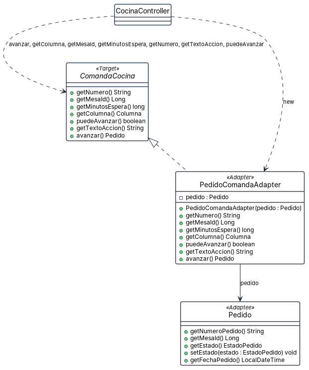

# Patrón Adapter · el tablero de cocina

**Por qué está.** El tablero de cocina razona en comandas (columna, minutos de espera, texto del botón) y la base guarda pedidos, con estados, fechas e identificadores. Esta vista responde quién hace esa traducción y qué deja de saber la pantalla.

**Qué muestra.** Son 4 cajas y 4 flechas, 1 de realización, con 1 atributo y 20 operaciones. ComandaCocina es el Target con las operaciones que el tablero espera, PedidoComandaAdapter las implementa por composición y de Pedido, que es el Adaptee, solo se dibujan los métodos que el adaptador le llama. La prueba de que el patrón manda está en CocinaController: sale únicamente hacia la interfaz, y hacia el adaptador solo para construirlo. Queda una grieta visible en la propia firma del Target: avanzar() devuelve un Pedido, así que el Adaptee reaparece en la interfaz que decía no conocerlo.
