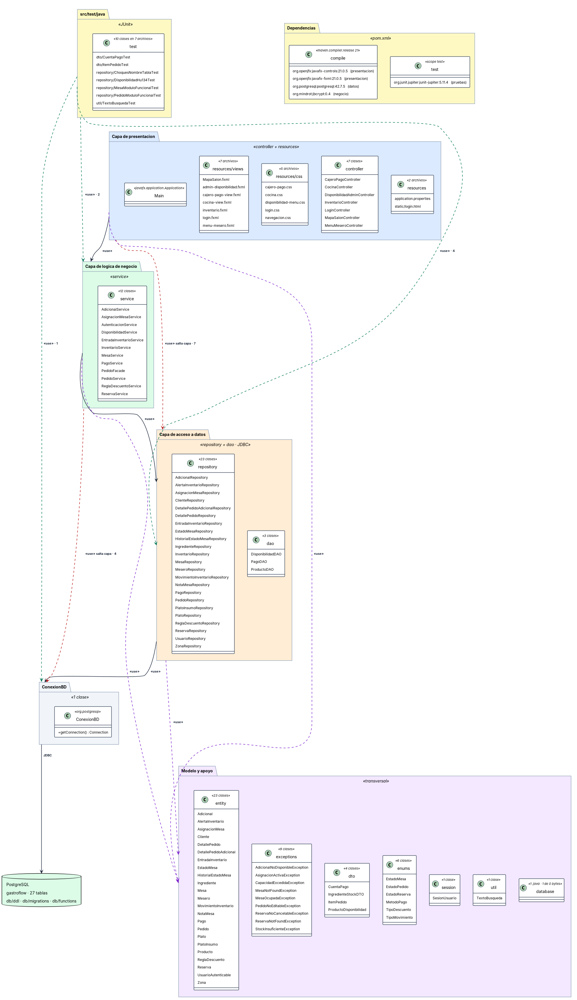
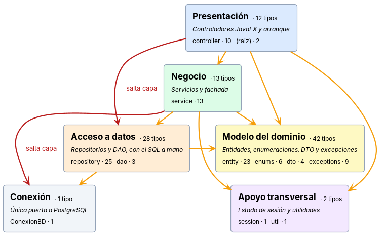
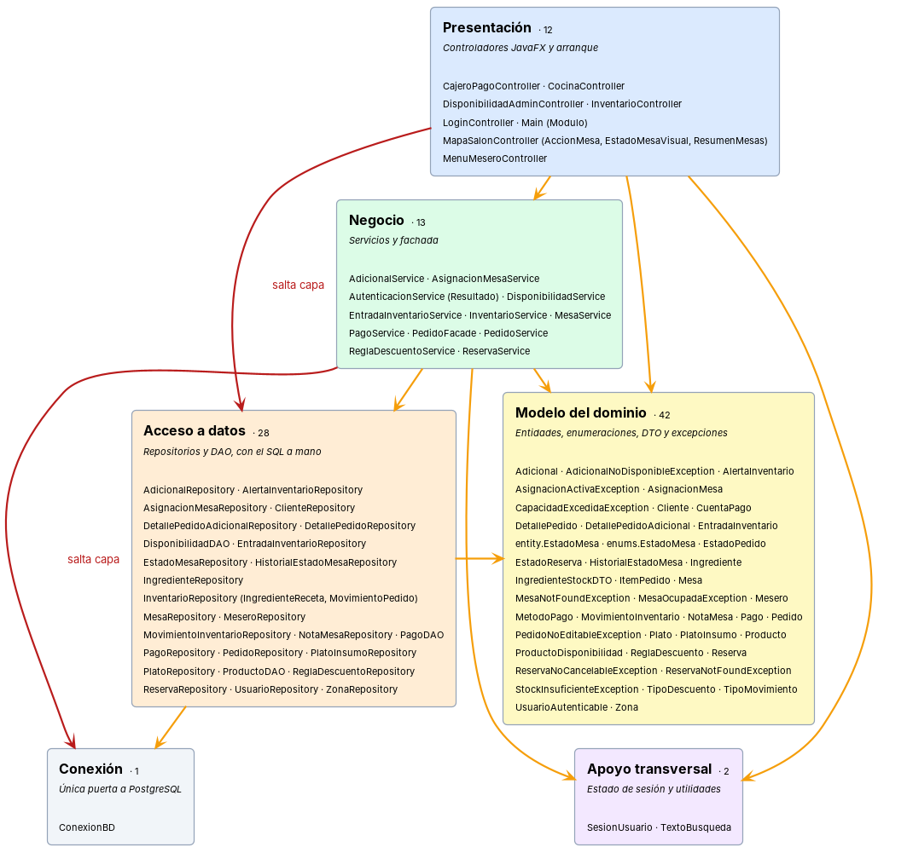

# Diagrama de arquitectura

Documenta en una sola vista cómo está organizado el código y qué depende de qué, y contrasta el resultado con la decisión de arquitectura registrada en architecture.md.

---

## Organización del código en capas y dependencias entre ellas

**Por qué está.** Responde, en una sola vista, cómo está organizado el código y qué depende de qué, sin tener que recorrer los archivos uno por uno. Comprueba además si el código cumple la decisión registrada en architecture.md: JavaFX con JDBC y sin Spring.

**Qué muestra.** Son 20 elementos y 12 dependencias: cuatro entre capas contiguas, dos saltos de capa, tres hacia el modelo y tres desde las pruebas. Los paquetes de src/main/java se agrupan en presentación, negocio, datos e infraestructura, con los recursos y PostgreSQL. Los tres DAO están en la capa de datos y no en la de negocio, porque ejecutan SQL igual que un repositorio. El diagrama no esconde los incumplimientos: marca los saltos de capa que el código comete y cuántas veces ocurre cada uno, sobre todo desde presentación hacia datos. Debajo van las dos versiones ligeras de esta misma estructura, sin los archivos ni las flechas de punta a punta: la primera dice de qué se compone cada capa y cuánto pesa, y la segunda añade los nombres de las clases. Las dos marcan en rojo los mismos dos saltos de capa.
