# Diagramas de clases

Documentan el modelo de clases del sistema: 98 tipos, 371 atributos y 663 métodos. Están organizados siguiendo la arquitectura en capas del proyecto: primero dos vistas ligeras de todo el modelo, después las entidades del dominio, después cada capa con sus miembros, y al final las relaciones, separadas por origen y destino para que cada vista responda una sola pregunta.

---

## De un vistazo: en cuántas partes está dividido el modelo

**Por qué está.** Es la vista más lejana de todas. No da nombres de clase: responde cuántas partes hay, de qué tamaño es cada una y en qué orden dependen unas de otras, que es lo primero que hay que saber al llegar al proyecto.

**Qué muestra.** Los 98 tipos del código en seis bloques, con los paquetes que forman cada uno y cuántos tipos trae cada paquete. El acceso a datos y el modelo del dominio son, con diferencia, las dos partes más grandes: entre las dos suman más de dos tercios del código. El detalle de qué clase está dónde está en el mapa siguiente.

---

## Mapa del modelo: qué clases hay y en qué capa vive cada una

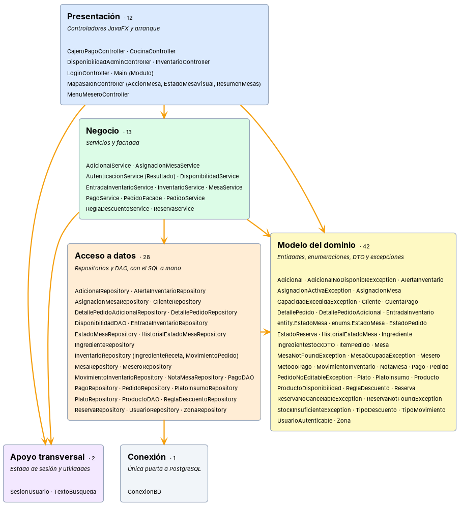

**Por qué está.** Los quince diagramas que siguen llevan los atributos y los métodos de cada clase, que es lo que hace falta para trabajar pero no para orientarse. Esta vista es la entrada: una banda por capa con los nombres de sus clases y nada más.

**Qué muestra.** Están los 98 tipos del código repartidos en seis bloques. La columna de la izquierda es el camino normal de una operación, de la pantalla al servicio, de ahí al repositorio y de ahí a la única clase que abre la conexión. A la derecha, el modelo del dominio, que es casi la mitad de las clases y lo usan las tres capas de la columna. Las clases anidadas van entre paréntesis detrás de la que las contiene, porque no son archivos propios.

---

## Entidades del dominio (A): adicionales, inventario, mesas y clientes

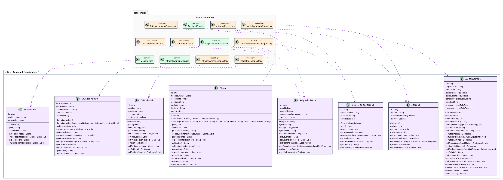

**Por qué está.** Las entidades son el vocabulario del sistema: los servicios, los repositorios y las pantallas se definen todos en términos de ellas, así que el modelo empieza por aquí. Este bloque cubre la parte del negocio que sostiene la carta y el salón.

**Qué muestra.** Hay 19 clases y 1 interfaz, con sus atributos y sus métodos. Se ve que un adicional se asocia a un detalle de pedido a través de DetallePedidoAdicional, que la asignación de una mesa es una entidad propia y no un campo de Mesa, y que las alertas de inventario se guardan en lugar de calcularse al vuelo. Junto a cada entidad aparece el repositorio que la maneja y, cuando existe, el servicio: la mayoría de estas entidades no tiene servicio propio y se usa directamente desde su repositorio.

---

## Entidades del dominio (B): mesas, historial e inventario

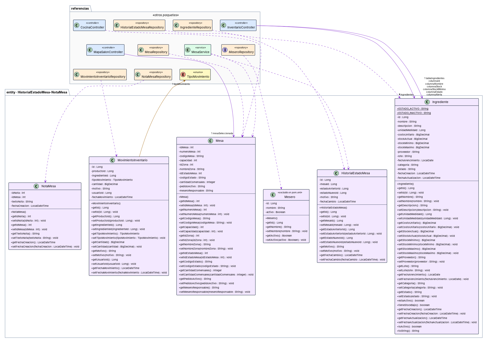

**Por qué está.** Aquí está el núcleo del salón. La mesa es la entidad con más estados y más escrituras concurrentes del sistema, y entenderla es condición para leer el diagrama de estados y el de componentes de datos.

**Qué muestra.** Son 17 tipos. Mesa no guarda su estado como texto sino como clave hacia el catálogo estados_mesa, y los cambios que pasan por MesaService dejan una fila en HistorialEstadoMesa: el historial es parte del modelo, no una tabla de auditoría añadida aparte. No todos pasan por ahí, y el diagrama de estados de la mesa marca cuáles se saltan el historial. NotaMesa cuelga de la mesa con una nota por mesa como máximo. El enum TipoMovimiento solo tiene dos valores, VENTA_COMANDA y REVERSO_COMANDA: clasifica la salida de inventario que genera una comanda y su reverso.

---

## Entidades del dominio (C): pedidos, pagos, carta y reservas

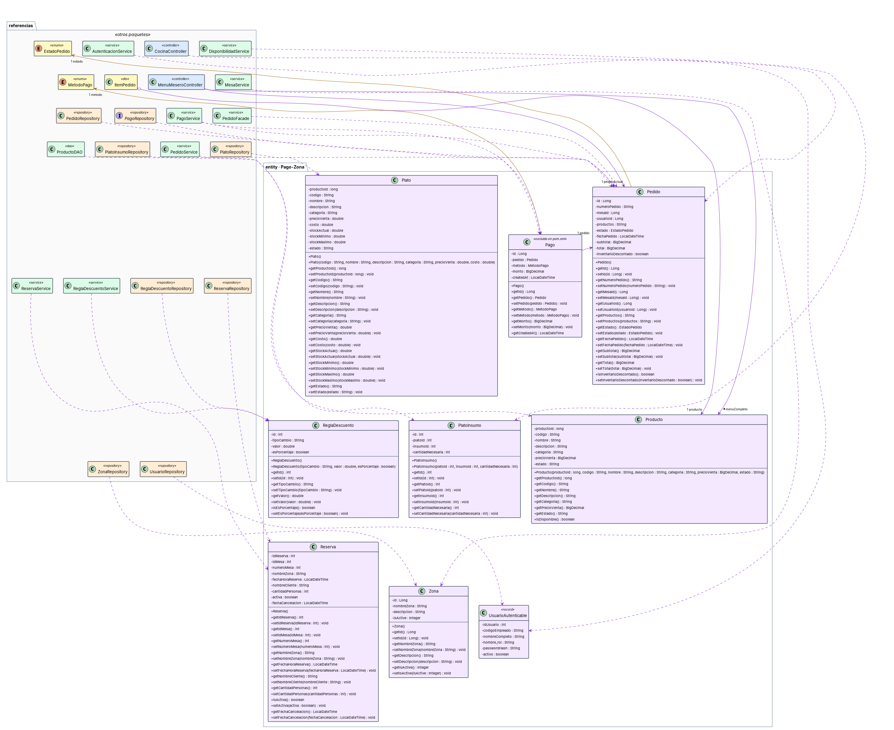

**Por qué está.** Cierra el modelo con el flujo que da sentido al resto: un pedido se abre sobre una mesa, se llena con productos de la carta y termina en un pago. Las dos enumeraciones que gobiernan ese flujo se declaran aquí.

**Qué muestra.** Son 31 tipos. EstadoPedido define los seis estados por los que pasa una comanda, y MetodoPago las formas de cobro. Pago no cuelga del pedido por composición sino que lo referencia, de modo que un pedido puede existir sin pago; eso sí, la entidad Pago es una de las que el pom.xml excluye de la compilación, así que el cobro que de verdad funciona no pasa por ella: lo resuelve PagoDAO escribiendo en la tabla pagos. Reserva apunta a la mesa y no al revés, y Zona agrupa las mesas del salón.

---

## Capa de presentación: los controladores JavaFX

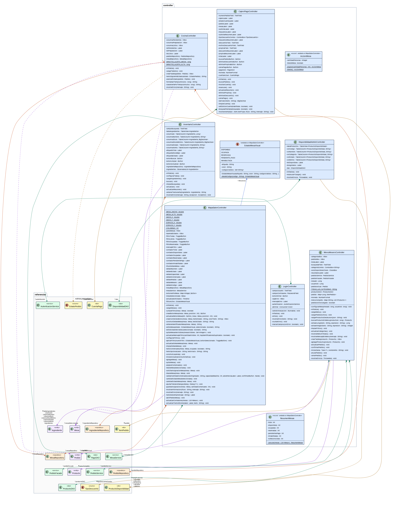

**Por qué está.** Cada pantalla de la aplicación es un controlador, así que este diagrama es el inventario de lo que el usuario puede hacer. Sirve para saber qué funcionalidad está construida y cuál sigue sin interfaz.

**Qué muestra.** Son 29 tipos y 12 relaciones. Hay siete pantallas con código: acceso, mapa de salón, carta del mesero, cocina, caja, inventario y disponibilidad. El octavo controlador, PagoController, es un archivo vacío que el pom.xml excluye de la compilación. El mapa de salón es con diferencia el controlador más grande, y declara dentro sus propias clases auxiliares (AccionMesa, ResumenMesas) y el enum EstadoMesaVisual, que traduce los códigos de la base a colores y etiquetas de pantalla.

---

## Capa de acceso a datos: los repositorios

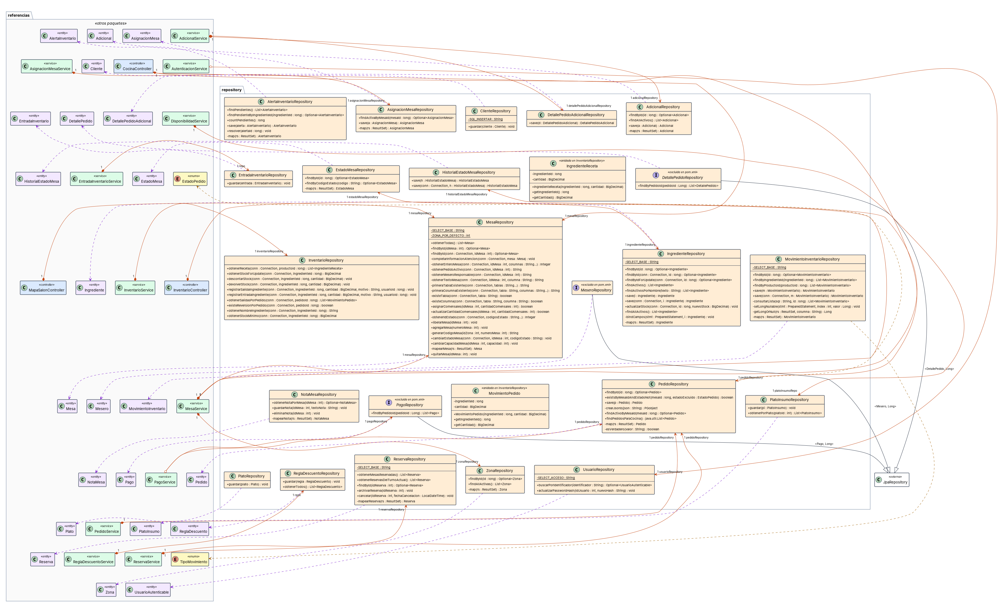

**Por qué está.** La decisión de arquitectura fue JDBC sin ORM, lo que significa que cada repositorio escribe su propio SQL. Esa decisión concentra aquí el riesgo de inconsistencia, y por eso la capa se documenta completa.

**Qué muestra.** Son 64 tipos y 27 relaciones. Los repositorios que se ejecutan exponen métodos de consulta con nombre propio en lugar de un CRUD genérico, porque las consultas están escritas a mano. Tres interfaces (DetallePedidoRepository, MeseroRepository y PagoRepository) extienden JpaRepository y son el residuo de la etapa con Spring: el pom.xml las excluye de la compilación y no forman parte del sistema que se ejecuta.

---

## Capa de negocio: servicios y DAO

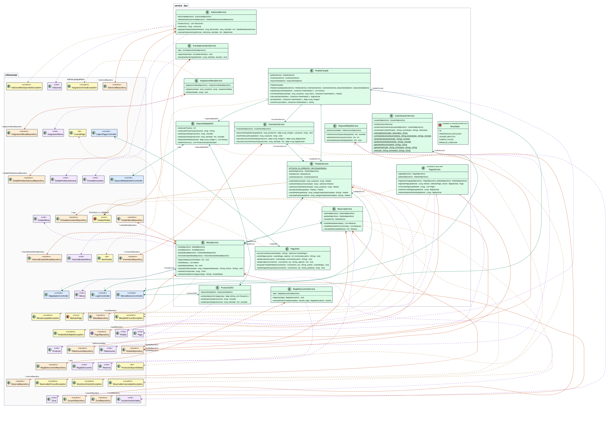

**Por qué está.** Es la capa donde se decide si una operación es válida. Documentarla completa es lo que permite comprobar que las reglas viven en un solo sitio y no repartidas entre dos estilos de clase.

**Qué muestra.** Son 64 tipos y 33 relaciones. Conviven doce servicios y tres DAO (DisponibilidadDAO, PagoDAO y ProductoDAO) que hacen el mismo trabajo con otro nombre: los tres ejecutan SQL directamente, así que pertenecen a la capa de datos aunque estén en el paquete dao. PedidoFacade agrupa el flujo de pedido detrás de una sola interfaz, que es el patrón Facade aplicado en el proyecto.

---

## Excepciones, enumeraciones, DTO y arranque

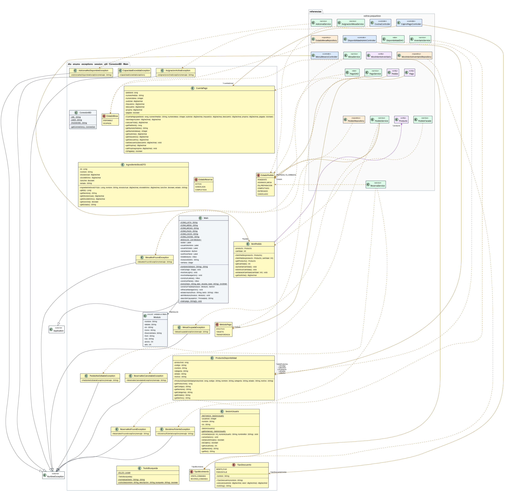

**Por qué está.** Las excepciones definen el contrato de error del sistema: qué puede fallar y con qué nombre. Junto con las enumeraciones son el vocabulario que atraviesa todas las capas, y por eso se documentan juntas.

**Qué muestra.** Son 47 tipos. Las nueve excepciones propias nombran reglas de negocio concretas (MesaOcupadaException, PedidoNoEditableException, StockInsuficienteException), de modo que una regla rota se distingue de un fallo técnico. Los DTO transportan datos agregados que no corresponden a una sola entidad, como CuentaPago o ProductoDisponibilidad. Main es el punto de entrada JavaFX.

---

## Qué llama la presentación hacia abajo

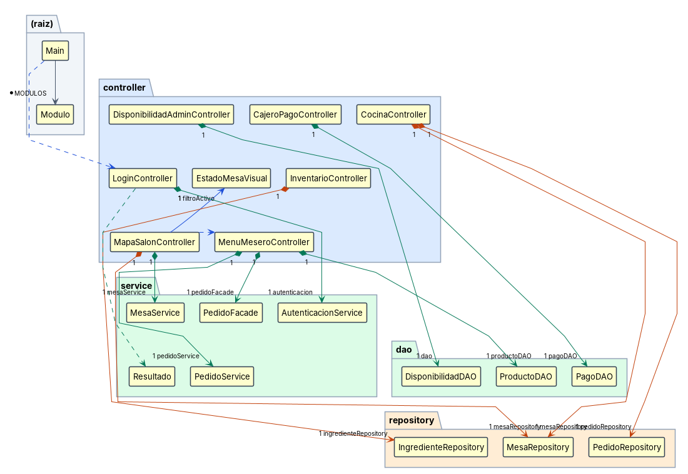

**Por qué está.** Una arquitectura en capas solo se sostiene si las llamadas respetan el orden. Este diagrama responde si la presentación pasa siempre por la capa de negocio o si atajaba hacia los datos.

**Qué muestra.** Son 21 tipos y 5 relaciones. La respuesta es que no siempre pasa: hay controladores que llaman directamente a repositorios y a DAO, saltándose los servicios. El mapa de salón es el caso más claro, y es el mismo salto que reaparece en el diagrama de estados de la mesa como escritura sin auditoría.

---

## Qué entidades manipula la presentación

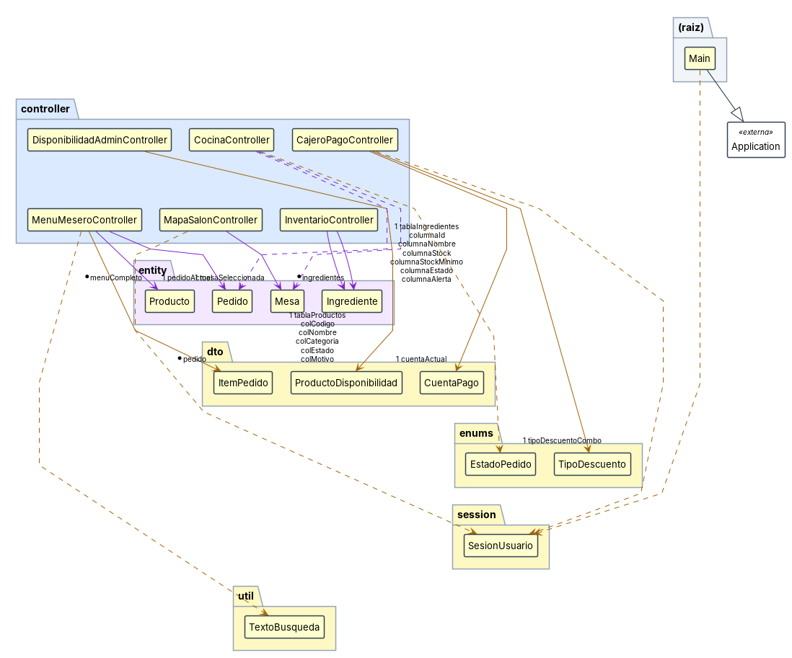

**Por qué está.** Complementa al anterior con la otra pregunta: además de a quién llama, qué datos del dominio toca cada pantalla directamente.

**Qué muestra.** Son 19 tipos y 16 relaciones. Los controladores construyen y modifican entidades por su cuenta, no solo DTO, y usan los enums del dominio para decidir qué pintar. Es lo que explica que la lógica de estado del pedido esté repartida entre el servicio y la pantalla de cocina.

---

## Qué usa la capa de negocio para llegar a los datos

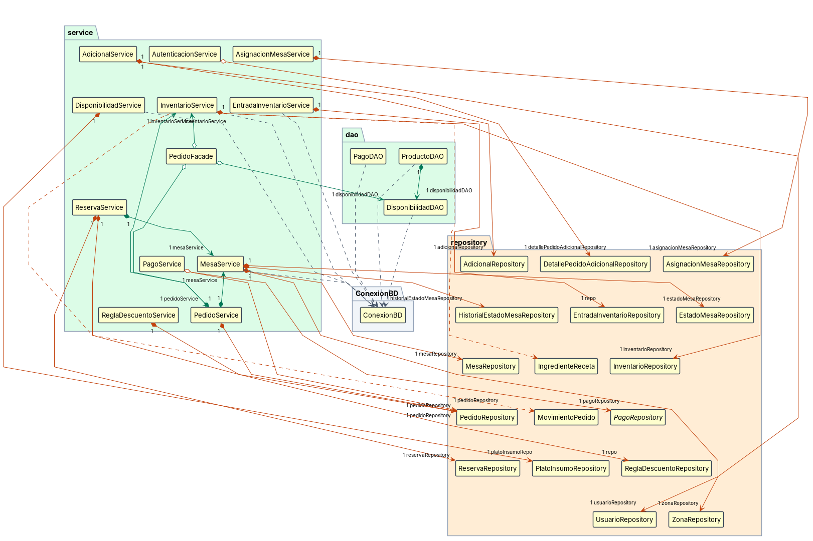

**Por qué está.** Es el camino normal de una operación: una pantalla pide algo a un servicio y el servicio lo resuelve contra la base. Este diagrama lo traza entero.

**Qué muestra.** Son 33 tipos y 9 relaciones. Siete de los doce servicios dependen de un único repositorio; el que más cruza es MesaService, con cuatro. Tres se apoyan en otros servicios además de, o en vez de, repositorios: PedidoService, ReservaService y PedidoFacade. PedidoFacade es el único que no toca ningún repositorio, y eso es lo que hace de él una fachada.

---

## Qué entidades construye y modifica cada servicio

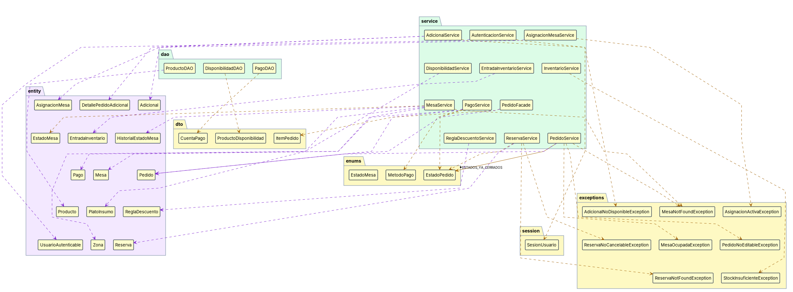

**Por qué está.** Permite saber quién es responsable de cada entidad: si dos servicios escriben la misma, hay una regla de negocio repartida en dos sitios.

**Qué muestra.** Son 44 tipos. Muestra con qué entidades y con qué enumeraciones trabaja cada servicio. EstadoPedido aparece en tres servicios y EstadoMesa solo en MesaService, que es donde se concentra el cambio de estado de la mesa. Las transiciones de los dos se documentan en su propio diagrama.

---

## Comprobación: los repositorios no llaman hacia arriba

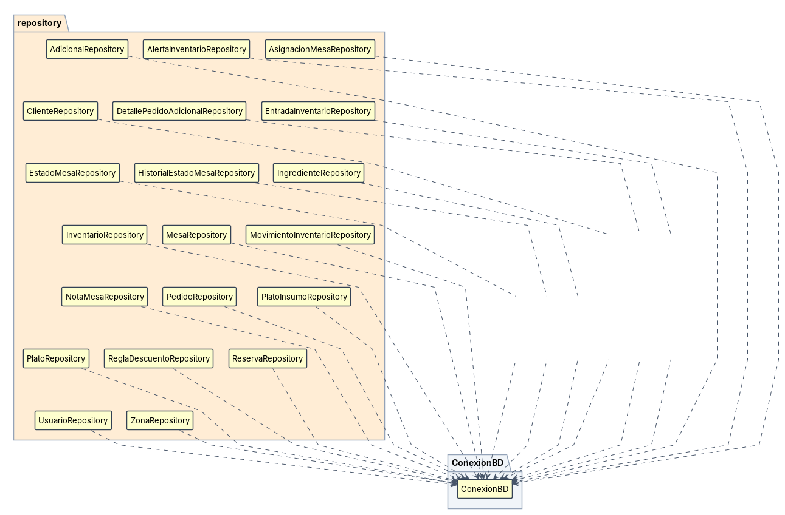

**Por qué está.** En una arquitectura en capas la de datos debe ser la última: puede ser llamada, pero no debe llamar a negocio ni a presentación. Este diagrama existe para verificarlo.

**Qué muestra.** Son 21 tipos y el resultado es que la comprobación se cumple: no hay flechas saliendo de la capa de datos hacia arriba. La única relación entre iguales es ProductoDAO hacia DisponibilidadDAO, dentro de la misma capa, y queda recogida en el diagrama de componentes de datos.

---

## Qué entidad lee y escribe cada repositorio

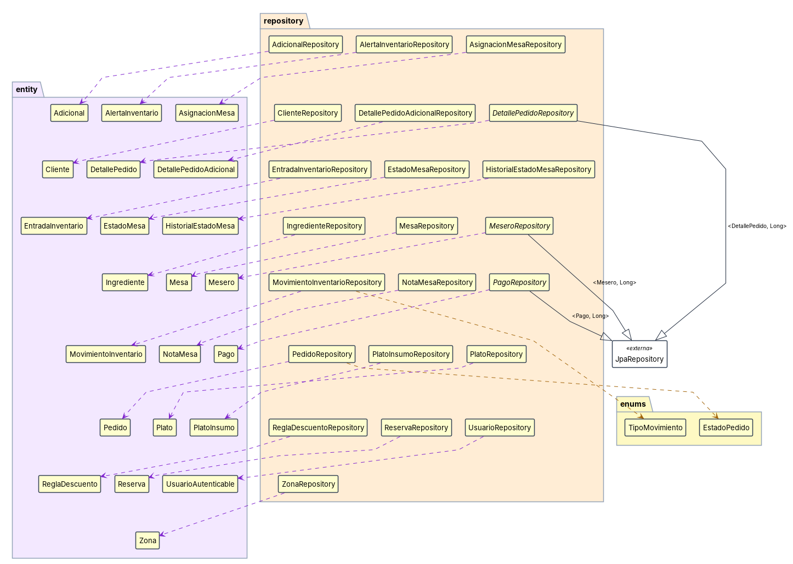

**Por qué está.** Sin ORM, la correspondencia entre clase y tabla no está declarada en ninguna anotación: hay que deducirla del SQL. Este diagrama la deja escrita, y es lo que permite rastrear quién toca cada dato.

**Qué muestra.** Son 47 tipos y 27 relaciones. La mayoría de repositorios mapean una entidad cada uno, pero algunos leen varias para componer un resultado. Las tres relaciones de herencia que aparecen son las de las interfaces de Spring que no compilan.

---

## Cómo se relacionan las entidades entre sí

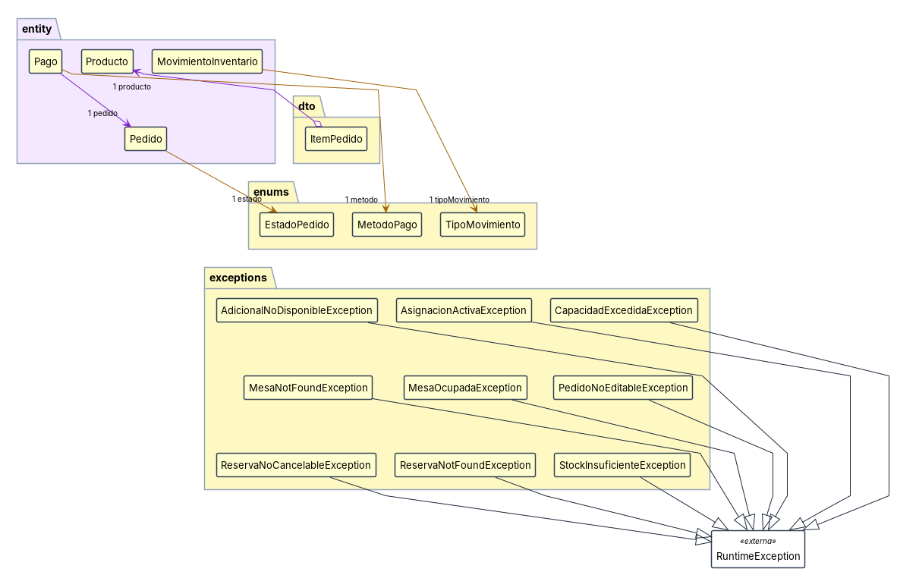

**Por qué está.** Es el modelo conceptual del negocio, sin capas ni tecnología: qué pertenece a qué y con qué cardinalidad. Es la vista que hay que contrastar con el modelo de base de datos.

**Qué muestra.** Son 18 tipos y 13 relaciones, deducidas de los campos que declara cada entidad. Ninguna entidad guarda una colección: las líneas de un pedido no viven dentro de Pedido sino en DetallePedido, con la clave del pedido, y quien dice que no tienen vida propia es el ON DELETE CASCADE del esquema, no el código Java. Un pago, en cambio, referencia al pedido sin ser parte de él.

---

## Qué cubren las pruebas automáticas

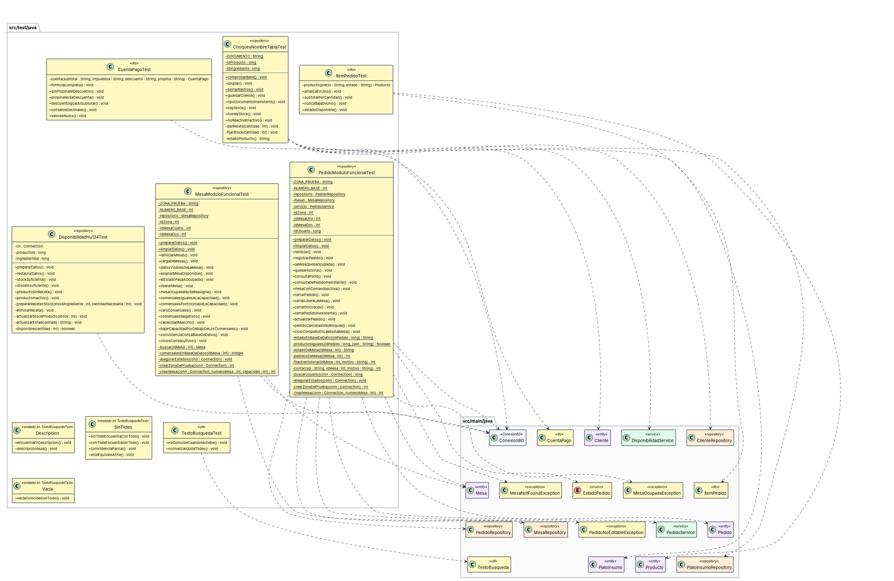

**Por qué está.** Las pruebas son parte de la entrega y delimitan qué partes del sistema están verificadas. Este diagrama responde qué se prueba y qué no.

**Qué muestra.** Son 29 tipos y 24 relaciones: 10 clases de prueba en 7 archivos, con las clases de producción que ejercita cada una. La cobertura funcional se concentra en mesas y pedidos, pero no son los únicos que necesitan la base: de los siete archivos, cuatro se conectan a PostgreSQL (los dos módulos funcionales, el de disponibilidad de la HU-134 y el de choques de nombre de tabla). Los otros tres son pruebas unitarias de clases sueltas: CuentaPago, ItemPedido y TextoBusqueda. Las clases anidadas son los grupos de casos de JUnit.
