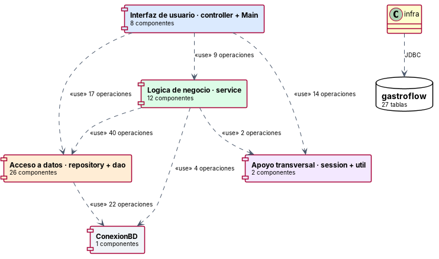
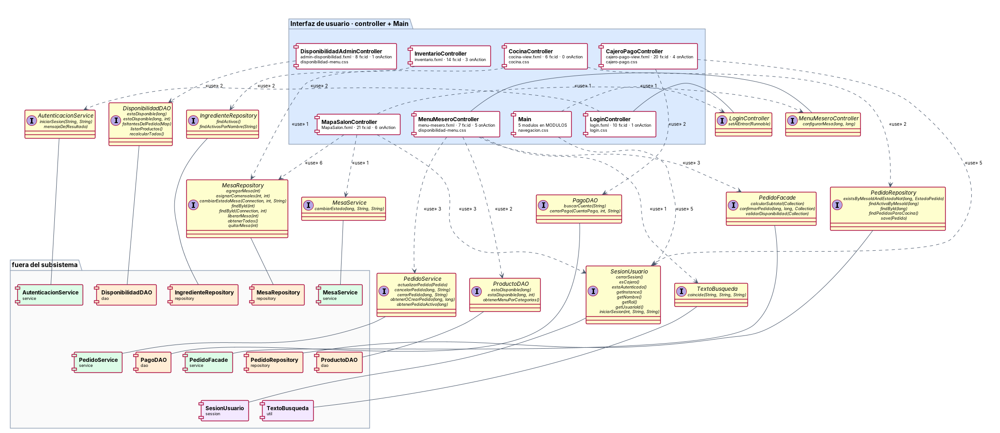
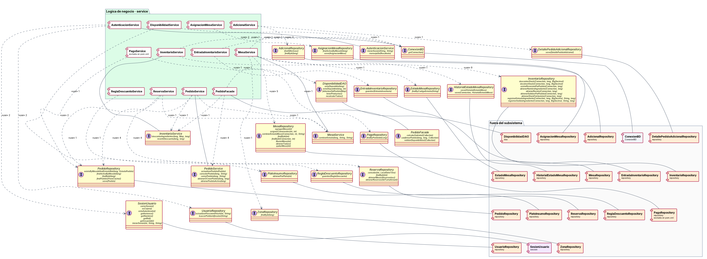
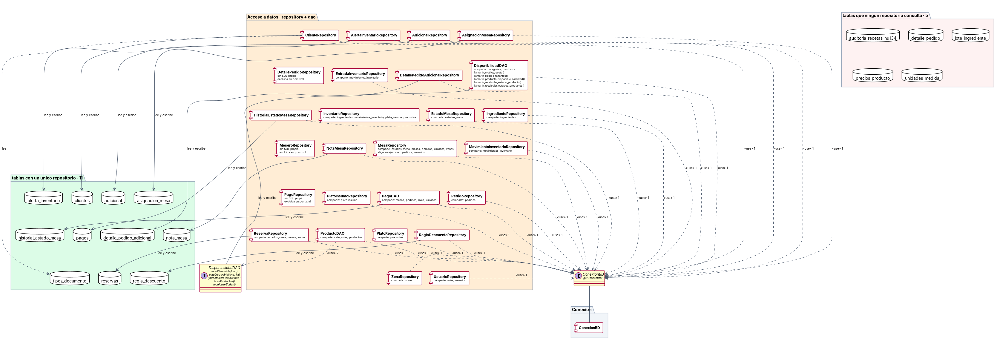
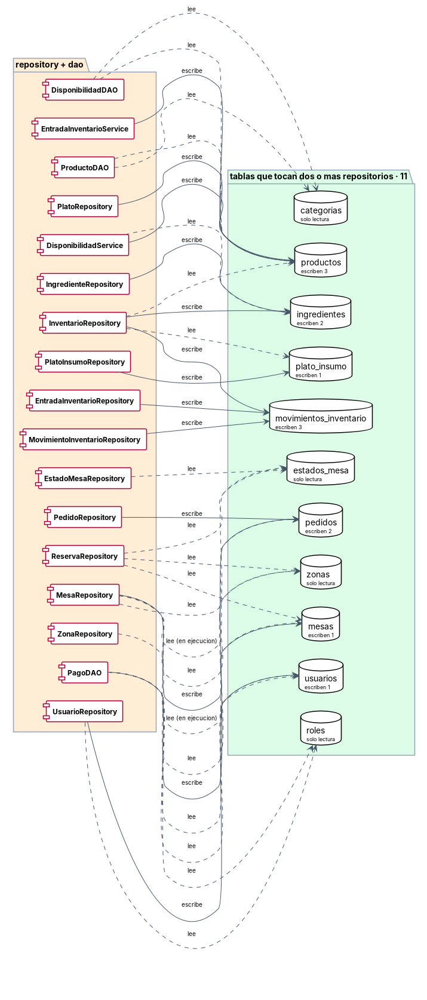
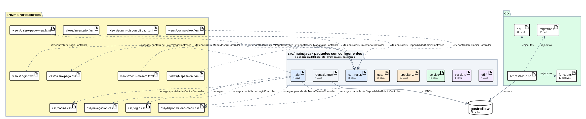
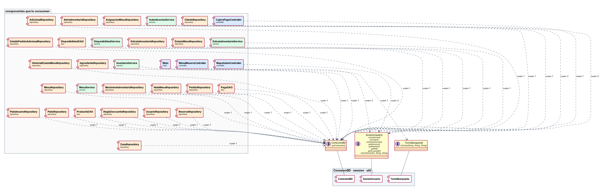
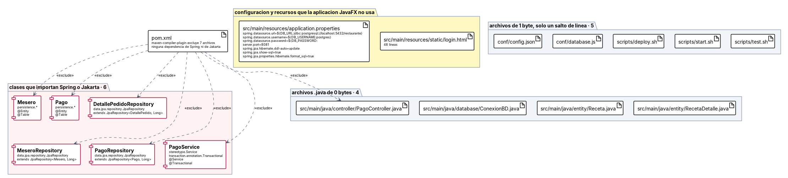

# Diagramas de componentes (vista detallada)

Documentan en qué piezas sustituibles está dividido el sistema y cómo dependen unas de otras, con las operaciones que cada componente provee y los archivos que lo forman. Las interfaces no son un diseño sobre el papel: cada una corresponde a las llamadas que de verdad cruzan el límite entre dos componentes. Para una lectura rápida sin este nivel de detalle está diagramaComponentesResumen.md. Arriba quedan los tres diagramas de componentes del taller 4 de análisis, uno por historia.

---

## Diagramas del taller 4 de análisis

Los que ya había entregado el equipo para las historias HU-012, HU-015 y HU-033, tal como se escribieron. Los nuevos van debajo.

### Diagrama Componentes - Registrar Plato

El componente Administrador (DisponibilidadAdminController) consume una interfaz de Lógica de Registro de Plato, que agrupa Plato, Receta, RecetaDetalle y PlatoIngrediente. Esta lógica usa el componente Persistencia (PlatoRepository, PlatoIngredienteRepository, RecetaDAO), que accede a la base de datos.

### Diagrama Componentes - Alerta Invetario

El componente Inventario (InventarioController, AlertaInventarioController) se conecta por interfaz con Gestión de Alertas (AlertaInventario, AlertaInventarioService). Este componente usa Persistencia (AlertaInventarioRepository, IngredienteRepository, MovimientoInventarioRepository), que accede a la base de datos.

### Diagrama Componentes - Control de cambios de Pedidos

El componente Mesero (MenuMeseroController) se comunica con Gestión de Pedidos (PedidoService, Pedido, DetallePedido, EstadoPedido). Esta se relaciona con Gestión de Inventario (InventarioService, MovimientoInventario) y con Persistencia (PedidoRepository, DetallePedidoRepository), que accede a la base de datos PostgreSQL.

---

## Los cinco grupos y su dependencia

**Por qué está.** Un componente es una pieza que se puede sustituir si se respeta su interfaz. Esta vista responde en cuántas piezas está dividido GastroFlow y en qué orden dependen unas de otras.

**Qué muestra.** El sistema se agrupa en interfaz, negocio, datos, conexión y apoyo. Las dependencias van en una sola dirección salvo las que atraviesan hacia datos desde la interfaz. Las interfaces provistas llevan el nombre real de la clase que las implementa: se dedujeron de las llamadas que cruzan el límite entre un grupo y otro, no de un diseño sobre el papel.

---

## Qué necesita cada pantalla para funcionar

**Por qué está.** Antes de tocar una pantalla conviene saber de qué depende. Esta vista lo resuelve pantalla por pantalla, incluidos los recursos que no son código.

**Qué muestra.** Son 20 componentes y 14 interfaces consumidas, con 17 conexiones. Cada componente agrupa su .fxml, su hoja de estilos y su controlador, de modo que se ve qué archivos hay que tocar para cambiar una pantalla. Las hojas de estilo las carga Main y no cada controlador, que es una dependencia fácil de pasar por alto.

---

## Cómo se apoyan los servicios entre sí

**Por qué está.** La capa de negocio es la que concentra las reglas. Esta vista muestra si están aisladas por componente o si un servicio depende de otro para cumplir su función.

**Qué muestra.** Son 30 componentes y 23 interfaces, con 28 conexiones. Aparece SesionUsuario, que es el Singleton del proyecto y el único estado global del sistema: lo consultan varias pantallas para saber el rol del usuario. PagoService figura marcada como excluida de la compilación, así que la gestión de pagos está incompleta a este nivel.

---

## Qué tabla toca cada componente de datos

**Por qué está.** Sin ORM esta correspondencia solo existe dentro de las cadenas de SQL. Hacerla explícita es lo que permite saber el impacto de cambiar una tabla antes de cambiarla.

**Qué muestra.** Son 29 componentes y 16 tablas, con 36 conexiones, y cada flecha sale de una consulta real. Los tres DAO aparecen aquí junto a los repositorios porque hacen lo mismo: ejecutar SQL. Las tablas que solo toca un componente son las de bajo riesgo; las compartidas van en el diagrama siguiente.

---

## Las tablas que escriben varios componentes

**Por qué está.** Una tabla escrita desde varios sitios es donde aparecen las inconsistencias, porque ningún componente ve lo que hacen los otros. Esta vista las aísla para poder vigilarlas.

**Qué muestra.** Son 11 tablas compartidas con 33 conexiones. El caso más expuesto es movimientos_inventario, escrita desde tres repositorios distintos. También lo están pedidos y mesas, que son justamente las dos entidades cuyos estados documentamos aparte.

---

## En qué archivo vive cada componente

**Por qué está.** Las vistas anteriores hablan de componentes lógicos. Para trabajar hace falta la correspondencia con los archivos reales del repositorio, y esta es la vista que la da.

**Qué muestra.** Son 24 artefactos y 18 relaciones. Relaciona los paquetes de código, los .fxml, las hojas de estilo y los recursos con el componente al que pertenecen. Sirve de índice para localizar dónde se implementa cada pieza.

---

## Las tres piezas de las que depende medio sistema

**Por qué está.** Hay componentes que no pertenecen a ninguna capa porque los usa todo el mundo. Son los que más cuesta cambiar, y por eso conviene saber exactamente quién los consume.

**Qué muestra.** ConexionBD abre todas las conexiones a PostgreSQL, SesionUsuario guarda quién ha iniciado sesión y TextoBusqueda normaliza las búsquedas. Entre las tres suman 31 consumidores. Cualquier cambio en su interfaz afecta a buena parte del sistema.

---

## El código de la etapa con Spring que ya no compila

**Por qué está.** El proyecto empezó con Spring y se unificó después en JavaFX con JDBC, según architecture.md. Parte de aquel código sigue en el repositorio. Documentarlo evita que alguien lo dé por funcional o intente usarlo.

**Qué muestra.** Son 12 artefactos. Seis clases importan Spring o Jakarta sin que el pom.xml declare esas dependencias, y el maven-compiler-plugin las excluye una por una de la compilación. Con ellas quedan fuera entidades y repositorios de pagos y meseros, que es la funcionalidad que falta completar.
