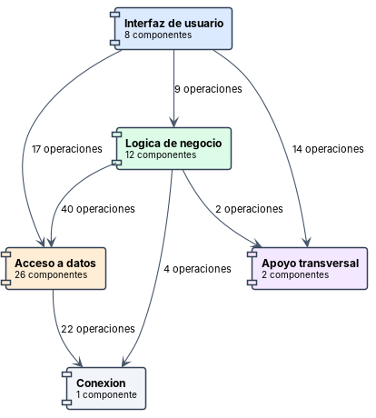
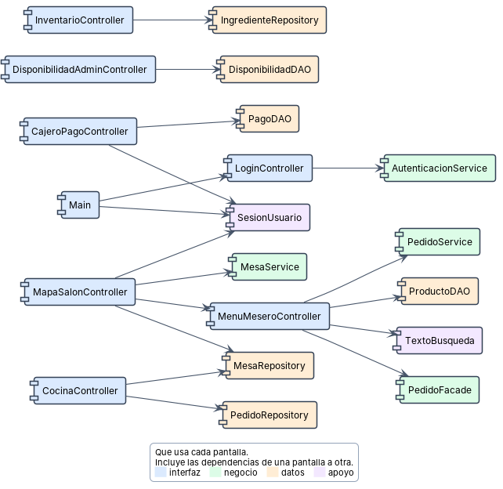
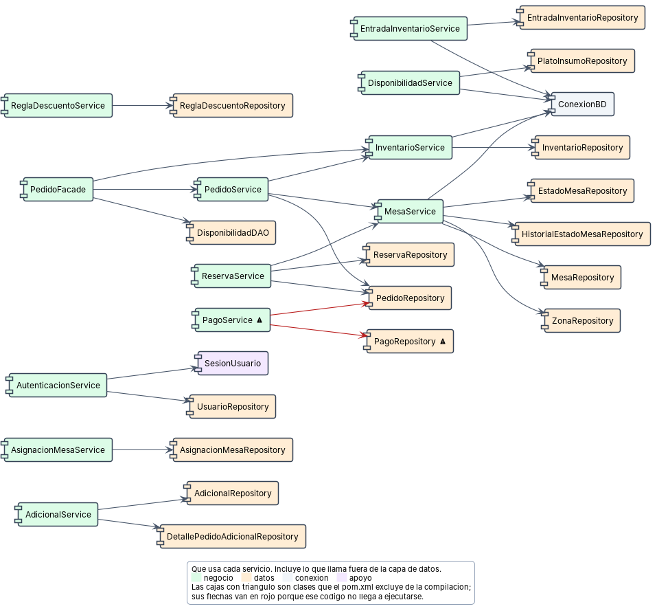
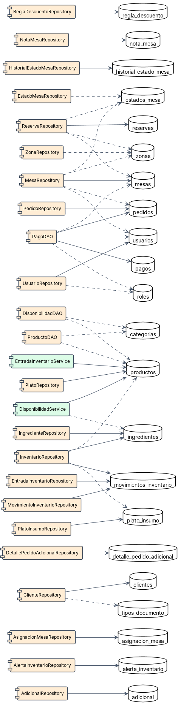
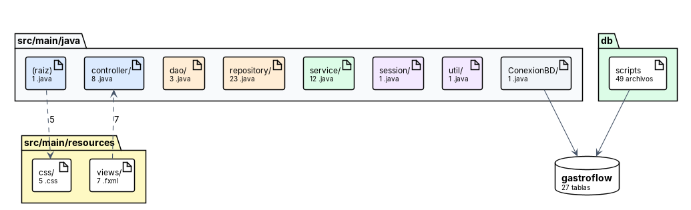
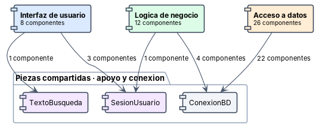

# Diagramas de componentes

Documentan en qué piezas sustituibles está dividido el sistema y cómo dependen unas de otras, con las operaciones que cada componente provee y los archivos que lo forman. Las interfaces no son un diseño sobre el papel: cada una corresponde a las llamadas que de verdad cruzan el límite entre dos componentes. Seis de las ocho vistas llevan debajo una versión resumida, con una caja por componente y una flecha por dependencia, para leerlas de un vistazo.

---

## Los cinco grupos y su dependencia

**Por qué está.** Un componente es una pieza que se puede sustituir si se respeta su interfaz. Esta vista responde en cuántas piezas está dividido GastroFlow y en qué orden dependen unas de otras.

**Qué muestra.** El sistema se agrupa en interfaz, negocio, datos, conexión y apoyo. Las dependencias van en una sola dirección salvo las que atraviesan hacia datos desde la interfaz. Las interfaces provistas llevan el nombre real de la clase que las implementa: se dedujeron de las llamadas que cruzan el límite entre un grupo y otro, no de un diseño sobre el papel.

---

## Qué necesita cada pantalla para funcionar

**Por qué está.** Antes de tocar una pantalla conviene saber de qué depende. Esta vista lo resuelve pantalla por pantalla, incluidos los recursos que no son código.

**Qué muestra.** Son 20 componentes y 14 interfaces consumidas, con 17 conexiones. Cada componente agrupa los archivos de su pantalla: el .fxml, el controlador y, cuando la tiene, su hoja de estilos. Inventario y el mapa de salón no tienen hoja propia, y Main no tiene .fxml porque arma su interfaz en código. Las hojas de estilo las carga Main y no cada controlador, que es una dependencia fácil de pasar por alto.

---

## Cómo se apoyan los servicios entre sí

**Por qué está.** La capa de negocio es la que concentra las reglas. Esta vista muestra si están aisladas por componente o si un servicio depende de otro para cumplir su función.

**Qué muestra.** Son 30 componentes y 23 interfaces, con 28 conexiones. Aparece SesionUsuario, que es el Singleton del proyecto y el único estado global del sistema: lo consultan el arranque y dos pantallas, casi siempre para saber si hay sesión y quién es; el rol solo se mira en Main y en la pantalla de caja. PagoService figura marcada como excluida de la compilación, así que el cobro funciona sin capa de servicio: la pantalla de caja escribe directamente por PagoDAO.

---

## Qué tabla toca cada componente de datos

**Por qué está.** Sin ORM esta correspondencia solo existe dentro de las cadenas de SQL. Hacerla explícita es lo que permite saber el impacto de cambiar una tabla antes de cambiarla.

**Qué muestra.** Son 29 componentes y 16 tablas, con 36 conexiones, y cada flecha sale de una consulta real. Los tres DAO aparecen aquí junto a los repositorios porque hacen lo mismo: ejecutar SQL. Las tablas que solo toca un componente son las de bajo riesgo; las compartidas van en el diagrama siguiente.

---

## Las tablas que tocan varios componentes

**Por qué está.** Una tabla escrita desde varios sitios es donde aparecen las inconsistencias, porque ningún componente ve lo que hacen los otros. Esta vista aísla las que tocan dos o más componentes para poder vigilarlas.

**Qué muestra.** Son 11 tablas compartidas con 33 conexiones. Solo se leen 4 de ellas (categorias, estados_mesa, roles, zonas), así que el riesgo está en el resto. Las más expuestas son movimientos_inventario y productos, con 3 componentes escribiendo en cada una; productos además recibe escrituras desde dos capas distintas, un repositorio y dos servicios. En mesas escribe un único componente aunque la consulten otros dos.

---

## En qué archivo vive cada componente

**Por qué está.** Las vistas anteriores hablan de componentes lógicos. Para trabajar hace falta la correspondencia con los archivos reales del repositorio, y esta es la vista que la da.

**Qué muestra.** Son 24 artefactos y 18 relaciones. Relaciona los paquetes de código, los .fxml, las hojas de estilo y los recursos con el componente al que pertenecen. Sirve de índice para localizar dónde se implementa cada pieza.

---

## Las tres piezas compartidas y quién las usa

**Por qué está.** Hay tres componentes que no pertenecen a ninguna capa. Conviene saber quién consume cada uno antes de tocarlo, porque el reparto es muy desigual y desde fuera no se adivina.

**Qué muestra.** ConexionBD abre todas las conexiones a PostgreSQL, SesionUsuario guarda quién ha iniciado sesión y TextoBusqueda normaliza las búsquedas. Entre las tres suman 31 consumidores, pero muy mal repartidos: 26 de ConexionBD, 4 de SesionUsuario, 1 de TextoBusqueda. Cambiar ConexionBD toca casi todo el sistema; cambiar TextoBusqueda toca una sola pantalla.
