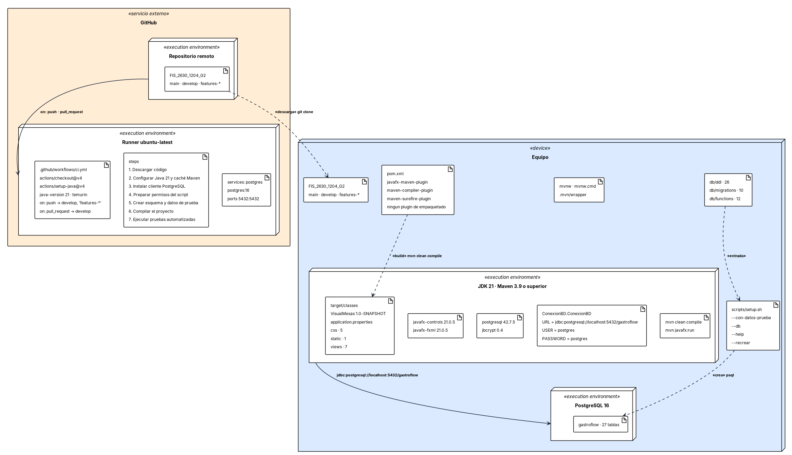

# Diagrama de despliegue

Documenta cómo se instala y se ejecuta el sistema hoy, y qué hace falta para ponerlo en funcionamiento. Arriba queda el diagrama de despliegue del taller 4 de análisis, que describe el despliegue previsto para las tres historias de ese taller.

---

## Diagramas del taller 4 de análisis

Los que ya había entregado el equipo para las historias HU-012, HU-015 y HU-033, tal como se escribieron. Los nuevos van debajo.

### Diagrama de Despliegue - Registro de plato, Alerta inventario y Control de cambios de pñedido

El sistema se despliega en tres nodos. En Dispositivos de Usuario, el Dispositivo Administrador ejecuta la UI Administrador y el Dispositivo Mesero ejecuta la UI Mesero. Ambos se comunican por API/TCP con el Servidor de Aplicaciones, que aloja el Módulo de Inventario (atiende al administrador) y el Módulo de Pedidos (atiende al mesero). Los dos módulos envían datos al Servidor de Base de Datos, donde PostgreSQL almacena las tablas. Es una arquitectura de tres capas.

---

## Cómo se instala y se ejecuta el sistema hoy

**Por qué está.** Responde qué hace falta para poner GastroFlow en funcionamiento. No dibuja servidores de aplicaciones porque no existen: el pom.xml no declara ningún plugin de empaquetado, así que el sistema no produce un instalable. Lo que sí existe, y es lo que documenta, son el entorno de desarrollo y el de integración continua.

**Qué muestra.** Son 6 nodos y 15 artefactos. Para ejecutarlo hacen falta JDK 21, Maven 3.9 o superior y PostgreSQL 16, con las dependencias que declara el pom (JavaFX 21.0.5, el driver postgresql 42.7.5 y jbcrypt 0.4). La base se prepara con los scripts de db/ y el arranque es mvn clean compile seguido de mvn javafx:run, contra la base en localhost:5432. El nodo de integración continua ejecuta los pasos declarados en .github/workflows/ci.yml.
