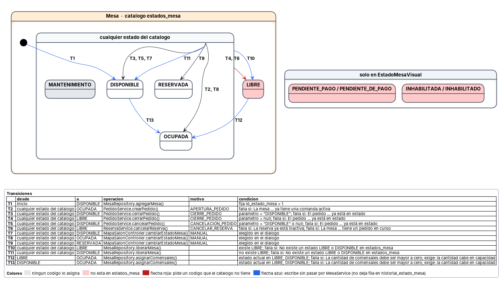

# Diagramas de estados

Documentan los estados por los que pasan un pedido y una mesa, y qué transiciones son válidas entre ellos. Cada flecha lleva un número y el detalle de cada transición está en la tabla que acompaña al diagrama.

---

## Estados por los que pasa un pedido y transiciones válidas

**Por qué está.** El estado de una comanda decide qué se puede hacer con ella: si se puede editar, cobrar o cancelar. Ese estado se cambia desde varios puntos del código, así que sin esta vista no hay forma de saber qué transiciones son válidas salvo leyéndolo entero.

**Qué muestra.** 6 estados y 6 transiciones. Un pedido nace PENDIENTE al abrirse sobre una mesa, avanza por cocina hasta COMPLETADO, y termina en ENTREGADO o CANCELADO, que son los dos estados cerrados. Cerrar y cancelar se pueden hacer desde cualquier estado activo: el código no mira en cuál está, solo que no sea uno de los dos finales. La tabla da por cada transición el origen, el destino, la operación que la ejecuta y la condición que debe cumplirse. ASIGNADO_MESA está en gris porque ningún código lo asigna, y las flechas azules señalan los cambios que se escriben sin pasar por PedidoService y por tanto sin la comprobación de estado cerrado.

---

## Estados por los que pasa una mesa y transiciones válidas

**Por qué está.** La mesa es el recurso que el salón reparte, y su estado determina si se puede sentar a alguien. A diferencia del pedido, su estado no es un enum de Java sino una fila de la tabla estados_mesa, y se cambia desde cinco puntos distintos.

**Qué muestra.** 4 estados de catálogo y 13 transiciones. La conclusión principal es que el sistema casi no restringe los cambios: salvo la asignación de comensales, que exige en su propio SQL que la mesa esté libre, ninguna transición consulta el estado actual, por eso las demás salen del bloque que agrupa todo el catálogo. MANTENIMIENTO está en el catálogo y ningún código lo asigna. LIBRE aparece en rojo porque el código lo pide y el catálogo no lo tiene. Las flechas azules escriben directamente en la tabla sin pasar por MesaService, de modo que esos cambios no quedan registrados en historial_estado_mesa.
