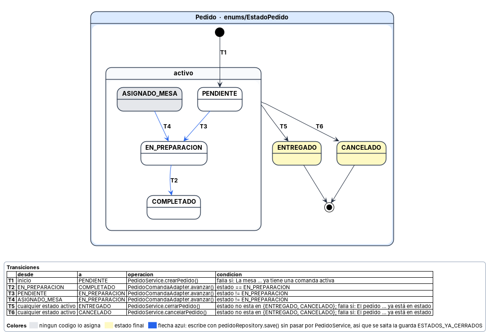

# Diagramas de estados

Documentan los estados por los que pasan un pedido y una mesa, y qué transiciones son válidas entre ellos. Cada flecha lleva un número y el detalle de cada transición está en la tabla que acompaña al diagrama.

---

## Estados por los que pasa un pedido y transiciones válidas

**Por qué está.** El estado de una comanda decide qué se puede hacer con ella: si se puede editar, cobrar o cancelar. Ese estado se cambia desde varios puntos del código, así que sin esta vista no hay forma de saber qué transiciones son válidas salvo leyéndolo entero.

**Qué muestra.** 6 estados y 6 transiciones. Un pedido nace PENDIENTE al abrirse sobre una mesa, avanza por cocina hasta COMPLETADO, y termina en ENTREGADO o CANCELADO, que son los dos estados cerrados. Cerrar y cancelar se pueden hacer desde cualquier estado activo: el código no mira en cuál está, solo que no sea uno de los dos finales. La tabla da por cada transición el origen, el destino, la operación que la ejecuta y la condición que debe cumplirse. ASIGNADO_MESA está en gris porque ningún código lo asigna, y las flechas azules señalan los cambios que se escriben sin pasar por PedidoService y por tanto sin la comprobación de estado cerrado.

