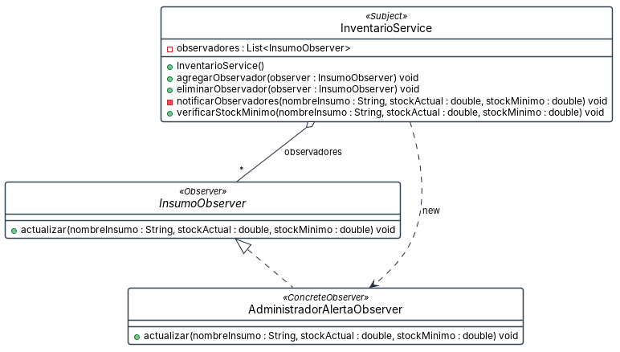

# Patrón Observer · HU #288 · la alerta de stock bajo

**Por qué está.** Cuando un insumo baja del mínimo hay que avisar, y el inventario no tiene por qué saber a quién. Esta vista responde quién publica el aviso y quién lo escucha.

**Qué muestra.** Son 3 cajas y 3 flechas, 1 de realización, con 1 atributo y 7 operaciones. InventarioService hace de sujeto: guarda la lista de observadores, ofrece alta y baja, y notificarObservadores la recorre; sus demás métodos son de inventario y no se dibujan. InsumoObserver declara la única operación del observador y AdministradorAlertaObserver la implementa. Importa lo que no aparece: no hay ninguna caja de cliente, porque nadie llama a verificarStockMinimo. La única flecha que entra al observador concreto es el new del propio constructor del sujeto, que se suscribe a sí mismo. El sujeto sabe notificar, pero nada lo pone en marcha.
