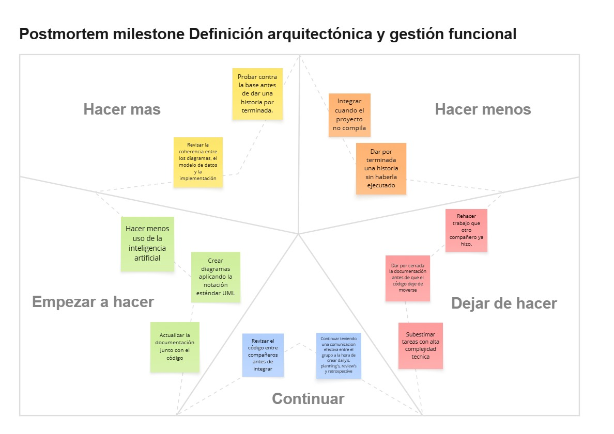

# Postmortem · Milestone Definición arquitectónica y gestión funcional

## Continuar

- Revisar el código entre compañeros antes de integrar.
- Mantener la comunicación del grupo en las dailys, plannings, reviews y retrospectivas.

## Hacer más

- Probar contra la base antes de dar una historia por terminada.
- Revisar la coherencia entre los diagramas, el modelo de datos y la implementación.

## Empezar a hacer

- Crear los diagramas aplicando la notación estándar UML.
- Actualizar la documentación junto con el código.
- Hacer menos uso de la inteligencia artificial.

## Hacer menos

- Integrar cuando el proyecto no compila.
- Dar por terminada una historia sin haberla ejecutado.

## Dejar de hacer

- Rehacer trabajo que otro compañero ya hizo.
- Dar por cerrada la documentación antes de que el código deje de moverse.
- Subestimar tareas con alta complejidad técnica.

