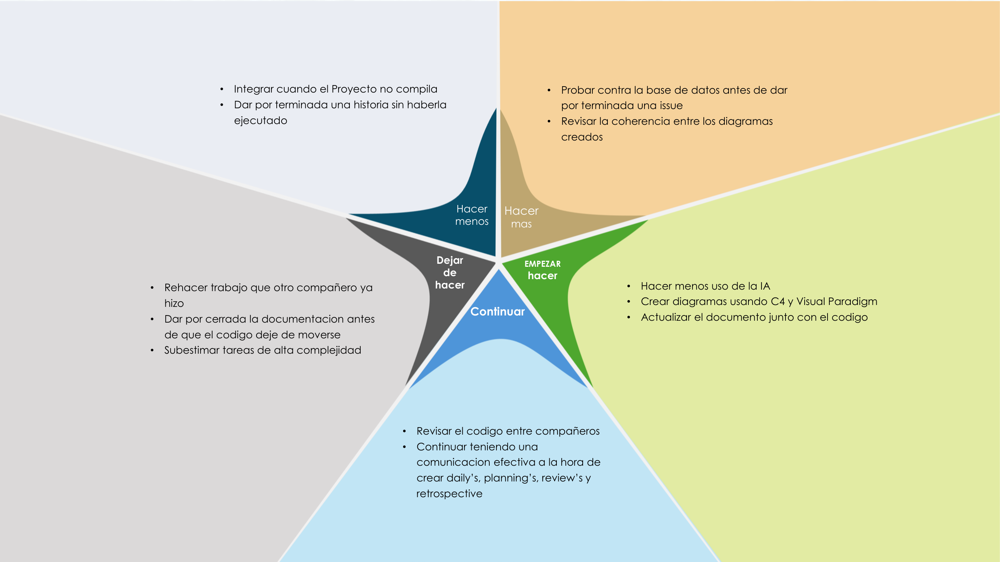

# Postmortem · Milestone Definición arquitectónica y gestión funcional

# Postmortem · Milestone Definición arquitectónica y gestión funcional

**HU-184 · Grupo 2 · GastroFlow**

## 1. Resumen

El milestone **Definición arquitectónica y gestión funcional** representó un avance importante en la consolidación técnica y funcional de GastroFlow. Durante su desarrollo, el equipo trabajó en 67 historias de usuario orientadas a fortalecer la arquitectura del sistema, mejorar el modelo de datos, implementar patrones de diseño, automatizar las pruebas y establecer buenas prácticas de desarrollo.

La metodología Scrum permitió organizar el trabajo mediante reuniones de planeación, dailys, revisiones y retrospectivas en cada sprint. Asimismo, la distribución de responsabilidades entre los cinco roles —Scrum Master, Product Owner, Configuration Manager, QA Lead y DevOps— facilitó la coordinación del equipo y el seguimiento de las actividades.

Uno de los aspectos más destacados fue el trabajo colaborativo. Cada integrante desarrolló sus actividades en ramas independientes, manteniendo un proceso de revisión de código entre compañeros antes de integrar los cambios. Esto permitió conservar un desarrollo organizado y fortalecer la calidad de las entregas.

Entre los principales resultados se encuentran la documentación de seis patrones de diseño con sus respectivos diagramas, la consolidación de una base de datos de 28 tablas que puede instalarse mediante un solo comando y la implementación de un proceso automatizado de integración continua que compila, ejecuta pruebas y analiza la calidad del código.

Estos resultados reflejan el compromiso del equipo con la construcción de un sistema más organizado, mantenible y preparado para incorporar nuevas funcionalidades.

## 2. Evaluación del producto y la calidad

El desarrollo del milestone permitió alcanzar resultados significativos en la evolución de GastroFlow, especialmente en los aspectos relacionados con su arquitectura, organización del código y calidad técnica.

La implementación y documentación de patrones de diseño contribuyó a establecer una estructura más clara para los diferentes componentes del sistema, facilitando su comprensión y mantenimiento.

Por otra parte, el trabajo sobre la base de datos permitió consolidar su estructura y simplificar el proceso de instalación, haciendo más sencilla la preparación del entorno de desarrollo para todos los integrantes.

También se fortaleció la organización del proyecto mediante el uso de ramas individuales, revisiones de código y commits relacionados con sus respectivas historias de usuario. Estas prácticas favorecieron la trazabilidad de los cambios y facilitaron el trabajo conjunto.

En términos generales, el producto evolucionó hacia una solución con una arquitectura mejor definida, procesos técnicos más organizados y herramientas que permiten verificar continuamente su funcionamiento.

## 3. Calidad del producto y validación mediante pruebas

Uno de los principales avances del milestone fue el fortalecimiento del proceso de aseguramiento de calidad mediante la incorporación de pruebas automatizadas y herramientas de análisis de código.

Durante el desarrollo se implementaron diferentes pruebas que permitieron validar el funcionamiento de los componentes del sistema, comprobar las reglas de negocio y fortalecer la confiabilidad de las funcionalidades desarrolladas.

Adicionalmente, se integró un proceso de automatización que ejecuta las pruebas cada vez que se realizan cambios en el repositorio. Esta implementación permitió agilizar las verificaciones y facilitar la identificación de posibles inconvenientes durante el desarrollo.

Otro resultado destacado fue el avance en la cobertura de pruebas de los servicios trabajados, lo que permitió comprobar de manera sistemática su comportamiento y fortalecer la estabilidad de GastroFlow.

La integración de estas herramientas también contribuyó a mejorar el proceso de revisión de código, proporcionando mecanismos que facilitan la validación de los cambios realizados por los integrantes del equipo.

En conjunto, estas actividades representaron un avance significativo en la calidad del producto, demostrando el compromiso del equipo con la implementación de buenas prácticas de desarrollo y la construcción de un sistema más confiable, organizado y mantenible.

## 4. Evaluación de roles y desempeño

La evaluación del desempeño del equipo se realizó considerando el aporte de cada proceso al cumplimiento de los objetivos del milestone.

**Liderazgo.** La definición de las historias de usuario y la asignación de responsabilidades permitieron mantener una organización clara del trabajo. Las reuniones de seguimiento facilitaron la comunicación entre los integrantes y contribuyeron a mantener una visión compartida de los objetivos del proyecto.

**Desarrollo.** El equipo mantuvo un flujo de trabajo basado en ramas independientes y revisiones de código entre compañeros. Esta dinámica permitió desarrollar funcionalidades de manera organizada, compartir conocimientos y facilitar la integración de los diferentes componentes del sistema.

**Planeación.** La división del milestone en historias de usuario con objetivos específicos favoreció la distribución de responsabilidades y permitió trabajar de forma progresiva en los diferentes componentes de GastroFlow. La metodología Scrum proporcionó espacios de coordinación y seguimiento durante cada sprint.

**Calidad.** La incorporación de pruebas automatizadas y herramientas de análisis representó uno de los mayores aportes al proyecto. Estas actividades fortalecieron la validación de funcionalidades y permitieron establecer mecanismos que facilitan el seguimiento de la calidad del código.

**Soporte y configuración.** La consolidación de la base de datos y la automatización de su instalación facilitaron la configuración del entorno de desarrollo. Asimismo, la organización del repositorio y los procesos de integración continua contribuyeron a mantener un entorno de trabajo más estructurado.

En general, el equipo demostró compromiso, responsabilidad y disposición para colaborar. La distribución de roles permitió aprovechar las capacidades de cada integrante y trabajar de manera coordinada hacia los objetivos comunes.

## 5. Mejoras propuestas y evolución del proyecto

El milestone permitió consolidar buenas prácticas de desarrollo que servirán como base para las siguientes etapas de GastroFlow.

Uno de los avances más importantes fue dar continuidad a los compromisos establecidos en retrospectivas anteriores, especialmente la documentación de patrones de diseño mediante diagramas y la revisión de código entre compañeros antes de integrar los cambios.

Para los siguientes sprints, el equipo continuará fortaleciendo estos procesos mediante la actualización constante de la documentación, la ampliación de las pruebas automatizadas y la optimización de los componentes del sistema.

También se propone continuar trabajando en el rendimiento de las consultas a la base de datos, la simplificación de su estructura y la implementación de nuevas pruebas en los servicios que contienen reglas de negocio importantes.

Estas iniciativas permitirán aprovechar los resultados alcanzados y seguir construyendo una aplicación más escalable, mantenible y confiable.

**El principal logro del milestone fue fortalecer la calidad técnica de GastroFlow, pasando de un sistema con funcionalidades implementadas a uno que también cuenta con herramientas para verificar su comportamiento de manera automática.**

Además de los resultados técnicos, el equipo fortaleció sus habilidades de colaboración, organización, comunicación y aplicación de buenas prácticas de ingeniería de software.

## 6. Diagrama de estrella de mar

El diagrama de estrella de mar permitió identificar las prácticas que contribuyeron positivamente al desarrollo del milestone, así como las oportunidades para continuar fortaleciendo los procesos del equipo.

La retrospectiva se organizó en cinco categorías: continuar, hacer más, empezar a hacer, hacer menos y dejar de hacer. Cada una reúne tres acciones concretas que reflejan las experiencias y aprendizajes adquiridos durante el desarrollo de GastroFlow.

### Continuar

| Frase                                                                              | Ejemplo y justificación                                                                                                                                                                                                               |
| ---------------------------------------------------------------------------------- | ------------------------------------------------------------------------------------------------------------------------------------------------------------------------------------------------------------------------------------- |
| Revisar el código entre compañeros antes de integrar                               | La revisión de código entre integrantes permitió compartir conocimientos, validar las implementaciones y fortalecer el trabajo colaborativo. Esta práctica contribuyó a mantener una organización adecuada de los cambios realizados. |
| Mantener la comunicación del equipo en dailys, plannings, reviews y retrospectivas | La aplicación de las ceremonias de Scrum facilitó la coordinación de las actividades, el seguimiento de las historias de usuario y la comunicación constante entre los cinco integrantes.                                             |
| Numerar cada commit con la historia que lo origina                                 | La asociación de los commits con sus respectivas historias de usuario permitió mantener la trazabilidad de los cambios y facilitar la identificación de las funcionalidades desarrolladas.                                            |

### Hacer más

| Frase                                                               | Ejemplo y justificación                                                                                                                                                                                                   |
| ------------------------------------------------------------------- | ------------------------------------------------------------------------------------------------------------------------------------------------------------------------------------------------------------------------- |
| Probar contra la base de datos antes de dar por terminada una issue | Realizar pruebas directamente sobre la base de datos permitirá comprobar que las funcionalidades interactúen correctamente con la información almacenada y fortalecerá la validación de las historias desarrolladas.      |
| Revisar la coherencia entre los diagramas creados                   | El milestone permitió documentar seis patrones de diseño con sus respectivos diagramas. Continuar revisando la relación entre las representaciones arquitectónicas facilitará la comprensión global del sistema.          |
| Automatizar la ejecución de las pruebas en cada push                | La implementación de integración continua permitió automatizar la ejecución de pruebas y agilizar la validación del sistema. Ampliar esta práctica facilitará la verificación constante del funcionamiento de GastroFlow. |

### Empezar a hacer

| Frase                                                           | Ejemplo y justificación                                                                                                                                                                                 |
| --------------------------------------------------------------- | ------------------------------------------------------------------------------------------------------------------------------------------------------------------------------------------------------- |
| Crear los diagramas usando C4 y Visual Paradigm                 | La utilización de estas herramientas y convenciones permitirá estandarizar los diagramas arquitectónicos, mejorar su presentación y facilitar la comprensión de los diferentes componentes del sistema. |
| Actualizar el documento junto con el código                     | Mantener la documentación actualizada durante el desarrollo de cada funcionalidad permitirá conservar una relación coherente entre el diseño arquitectónico y su implementación.                        |
| Escribir criterios de aceptación en cada issue antes de tomarla | Definir criterios de aceptación desde la planeación permitirá establecer objetivos verificables y facilitar la validación del trabajo realizado por cada integrante.                                    |

### Hacer menos

| Frase                                                | Ejemplo y justificación                                                                                                                                                                                        |
| ---------------------------------------------------- | -------------------------------------------------------------------------------------------------------------------------------------------------------------------------------------------------------------- |
| Integrar cuando el proyecto no compila               | Se propone fortalecer la validación de compilación antes de integrar los cambios, aprovechando las herramientas de automatización implementadas durante el milestone para mantener la estabilidad del sistema. |
| Dar por terminada una historia sin haberla ejecutado | Ejecutar y verificar cada funcionalidad antes de cerrar su historia permitirá confirmar su comportamiento y garantizar que los resultados correspondan con los objetivos definidos.                            |
| Usar la inteligencia artificial                      | Se propone utilizar la inteligencia artificial de manera más selectiva, priorizando el análisis propio, la comprensión del código y el desarrollo de las habilidades técnicas de los integrantes.              |

### Dejar de hacer

| Frase                                                                   | Ejemplo y justificación                                                                                                                                                                                |
| ----------------------------------------------------------------------- | ------------------------------------------------------------------------------------------------------------------------------------------------------------------------------------------------------ |
| Rehacer trabajo que otro compañero ya hizo                              | La distribución clara de responsabilidades y la comunicación constante permitirán aprovechar mejor los aportes individuales, evitando esfuerzos duplicados y fortaleciendo el desarrollo colaborativo. |
| Dar por cerrada la documentación antes de que el código deje de moverse | Se propone mantener la documentación como un proceso continuo que acompañe la evolución del código, asegurando que los diagramas y documentos representen correctamente la arquitectura del sistema.   |
| Subestimar tareas de alta complejidad                                   | Se busca fortalecer la estimación de las historias que requieren mayor esfuerzo técnico, considerando sus dependencias, alcance y complejidad para facilitar una planeación más precisa.               |

## 7. Conclusión

El milestone **Definición arquitectónica y gestión funcional** permitió alcanzar avances importantes en la consolidación de GastroFlow, tanto desde el punto de vista técnico como en la organización del equipo.

La documentación de patrones de diseño, la estructuración de la base de datos, la implementación de pruebas automatizadas y el fortalecimiento del proceso de integración continua representan resultados que contribuyen directamente a la calidad y mantenibilidad del sistema.

Asimismo, la aplicación de Scrum, la distribución de roles y las revisiones de código entre compañeros permitieron consolidar una dinámica de trabajo colaborativa, organizada y orientada al cumplimiento de objetivos.

**Como equipo, este milestone nos permitió fortalecer nuestros conocimientos, mejorar nuestras prácticas de desarrollo y construir una base arquitectónica más sólida para continuar con la evolución de GastroFlow.**

