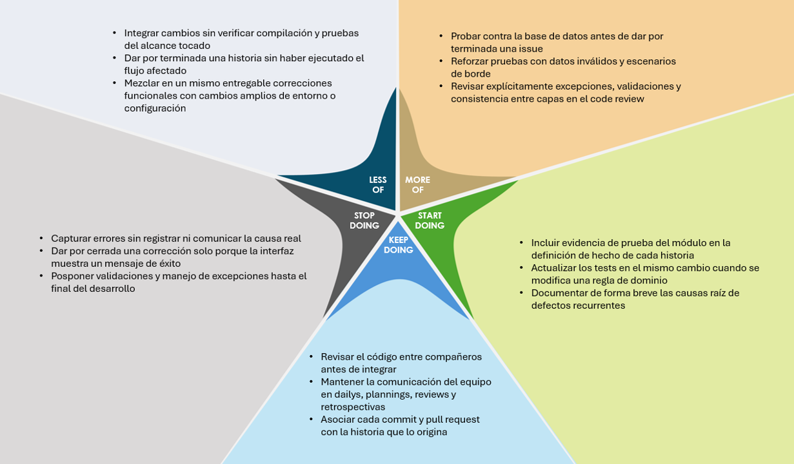

# Postmortem · Milestone Estabilización, control y manejo de errores

## 1. Resumen

El milestone **Estabilización, control y manejo de errores** representó un avance importante en la robustez operativa de GastroFlow. Durante su desarrollo, el equipo trabajó en historias de usuario orientadas a detectar y corregir fallos en flujos críticos, fortalecer validaciones ante datos o secuencias inválidas, mejorar el manejo de excepciones y consolidar el uso de pruebas automatizadas como mecanismo de control antes de integrar cambios.

La metodología Scrum permitió organizar el trabajo mediante planeación, seguimiento diario, revisiones y retrospectivas en cada sprint. La distribución de responsabilidades entre los roles del equipo facilitó la coordinación, el seguimiento de defectos y la priorización de correcciones que impactaban la operación diaria del sistema.

Uno de los aspectos más destacados fue el trabajo colaborativo. Cada integrante desarrolló sus actividades en ramas independientes, manteniendo un proceso de revisión de código entre compañeros antes de integrar los cambios. Esto permitió conservar un desarrollo organizado y reducir la incorporación de regresiones en la rama compartida.

Entre los principales resultados se encuentran la corrección de comportamientos inconsistentes en módulos de uso frecuente, el refuerzo de validaciones y reglas de estado, la alineación entre lo mostrado en la interfaz y lo persistido en base de datos, y el fortalecimiento del pipeline de integración continua como filtro de calidad al compilar y ejecutar pruebas.

Estos resultados reflejan el compromiso del equipo con la construcción de un sistema más estable, predecible y preparado para incorporar nuevas funcionalidades sin degradar la confiabilidad alcanzada.

## 2. Evaluación del producto y la calidad

El desarrollo del milestone permitió alcanzar resultados significativos en la evolución de GastroFlow, especialmente en los aspectos relacionados con la estabilidad de los flujos operativos y la calidad técnica de las correcciones.

La identificación y corrección de defectos en distintos módulos contribuyó a reducir comportamientos inesperados y a mejorar la experiencia de uso en escenarios reales de salón, pedidos, cocina e inventario, según los frentes abordados en cada sprint.

Por otra parte, el trabajo sobre validaciones y manejo de errores permitió que el sistema reaccionara de forma más controlada ante operaciones inválidas, disminuyendo la probabilidad de estados inconsistentes o de fallos difíciles de diagnosticar.

También se fortaleció la organización del proyecto mediante el uso de ramas individuales, revisiones de código y commits asociados a sus respectivas historias de usuario. Estas prácticas favorecieron la trazabilidad de los cambios y facilitaron el trabajo conjunto cuando una corrección impactaba más de una capa del sistema.

En términos generales, el producto evolucionó hacia una solución más confiable en los puntos estabilizados, con procesos técnicos más disciplinados y con mayor capacidad del equipo para verificar el comportamiento antes de dar por cerrada una entrega.

## 3. Calidad del producto y validación mediante pruebas

Uno de los principales avances del milestone fue el fortalecimiento del aseguramiento de calidad mediante pruebas manuales orientadas a bordes, pruebas automatizadas y el uso sistemático del pipeline de integración continua.

Durante el desarrollo se ejecutaron verificaciones que permitieron validar reglas de negocio, comprobar el efecto de las correcciones en la interfaz y contrastar resultados con la información almacenada, lo que fortaleció la confiabilidad de las funcionalidades corregidas.

Adicionalmente, el proceso de automatización que compila y ejecuta pruebas al integrar cambios facilitó la identificación temprana de inconvenientes, incluyendo desalineaciones entre el código y las aserciones de los tests, o fallos derivados del entorno de base de datos.

Otro resultado relevante fue el avance en pruebas unitarias centradas en reglas puras de dominio, sin depender necesariamente de la base de datos, lo que permitió validar de manera rápida y repetible comportamientos sensibles a estados y condiciones de error.

La integración de estas prácticas también contribuyó a mejorar el proceso de revisión de código, al contar con evidencia de ejecución de pruebas y con criterios más claros para aceptar o rechazar una historia.

En conjunto, estas actividades representaron un avance significativo en la calidad del producto, demostrando el compromiso del equipo con buenas prácticas de desarrollo y con la construcción de un GastroFlow más estable y mantenible.

## 4. Evaluación de roles y desempeño

La evaluación del desempeño del equipo se realizó considerando el aporte de cada proceso al cumplimiento de los objetivos del milestone.

**Liderazgo.** La priorización de defectos que afectaban la operación diaria y la definición clara de las historias permitieron mantener el foco en estabilización. Las reuniones de seguimiento facilitaron la comunicación y ayudaron a mantener una visión compartida de los objetivos de calidad.

**Desarrollo.** El equipo mantuvo un flujo de trabajo basado en ramas independientes y revisiones de código entre compañeros. Esta dinámica permitió corregir fallos de manera organizada, compartir conocimiento sobre causas raíz y facilitar la integración de cambios que tocaban varias capas del sistema.

**Planeación.** La división del milestone en historias con objetivos específicos favoreció la distribución de responsabilidades y un avance progresivo sobre distintos módulos. La metodología Scrum proporcionó espacios de coordinación y de ajuste del alcance cuando aparecían defectos no previstos.

**Calidad.** La incorporación y el uso más sistemático de pruebas automatizadas, junto con validaciones manuales de escenarios inválidos, representaron uno de los mayores aportes al milestone. Estas actividades fortalecieron la detección de regresiones y el seguimiento de la calidad del código.

**Soporte y configuración.** La estabilización de entornos de base de datos y la atención a la configuración local e integración continua facilitaron que el equipo pudiera reproducir y verificar defectos. La organización del repositorio y los procesos de CI contribuyeron a mantener un entorno de trabajo más controlado.

En general, el equipo demostró compromiso, responsabilidad y disposición para colaborar. La distribución de roles permitió aprovechar las capacidades de cada integrante y trabajar de manera coordinada hacia la estabilización del sistema.

## 5. Mejoras propuestas y evolución del proyecto

El milestone permitió consolidar prácticas de control de errores y verificación que servirán como base para las siguientes etapas de GastroFlow.

Uno de los avances más importantes fue dar continuidad a compromisos de retrospectivas anteriores, en particular la revisión de código entre compañeros, la ejecución de pruebas antes de integrar y la no aceptación de cambios que rompan la compilación o la suite básica del proyecto.

Para los siguientes sprints, el equipo continuará fortaleciendo estos procesos mediante la ampliación de pruebas de borde, la mejora de mensajes y manejo de excepciones, y la actualización de tests cuando cambien reglas de dominio.

También se propone seguir trabajando en la consistencia entre interfaz, lógica de negocio y persistencia, así como en la reducción de correcciones improvisadas que solo atienden el síntoma visible sin revisar el flujo completo.

Estas iniciativas permitirán aprovechar los resultados alcanzados y seguir construyendo una aplicación más estable, mantenible y confiable.

**El principal logro del milestone fue fortalecer la capacidad del equipo para detectar, corregir y prevenir errores, pasando de un sistema con funcionalidades operativas a uno con mejores mecanismos de control y verificación de su comportamiento.**

Además de los resultados técnicos, el equipo reforzó habilidades de diagnóstico, colaboración, comunicación y aplicación de buenas prácticas de ingeniería de software.

## 6. Diagrama de estrella de mar

El diagrama de estrella de mar permitió identificar las prácticas que contribuyeron positivamente al desarrollo del milestone, así como las oportunidades para continuar fortaleciendo los procesos del equipo.

La retrospectiva se organizó en cinco categorías: continuar, hacer más, empezar a hacer, hacer menos y dejar de hacer. Cada una reúne tres acciones concretas que reflejan las experiencias y aprendizajes adquiridos durante el trabajo de estabilización y control de errores en GastroFlow.

### Continuar

| Frase | Ejemplo y justificación |
| --- | --- |
| Revisar el código entre compañeros antes de integrar | La revisión entre integrantes permitió detectar validaciones incompletas, mal manejo de excepciones y desajustes entre capas antes de afectar la rama compartida, fortaleciendo el trabajo colaborativo y la calidad de las entregas. |
| Mantener la comunicación del equipo en dailys, plannings, reviews y retrospectivas | Las ceremonias de Scrum facilitaron el seguimiento de defectos, la priorización de bloqueos y la coordinación entre quienes corregían, probaban y revisaban los cambios. |
| Asociar cada commit y pull request con la historia que lo origina | La trazabilidad entre cambios e historias facilitó el seguimiento de correcciones, la revisión del alcance y la identificación de regresiones relacionadas con un entregable concreto. |

### Hacer más

| Frase | Ejemplo y justificación |
| --- | --- |
| Probar contra la base de datos antes de dar por terminada una issue | Contrastar el resultado de la interfaz con el estado real de los datos permite confirmar que la corrección persistió correctamente y evita cierres basados solo en un mensaje de éxito en pantalla. |
| Reforzar pruebas con datos inválidos y escenarios de borde | Validar entradas incorrectas, secuencias no habituales y estados límite fortalece el control de errores y reduce escapes de defectos hacia la rama de integración. |
| Revisar explícitamente excepciones, validaciones y consistencia entre capas en el code review | Enfocarse en estos puntos durante la revisión ayuda a prevenir fallos silenciosos, mensajes genéricos poco útiles y desalineaciones entre dominio, persistencia e interfaz. |

### Empezar a hacer

| Frase | Ejemplo y justificación |
| --- | --- |
| Incluir evidencia de prueba del módulo en la definición de hecho de cada historia | Exigir la ejecución de pruebas relevantes antes del cierre formaliza el control de calidad y evita integrar cambios solo porque compilan o porque el flujo feliz parece correcto. |
| Actualizar los tests en el mismo cambio cuando se modifica una regla de dominio | Mantener código y aserciones alineados previene fallos en integración continua y documenta el comportamiento esperado del sistema. |
| Documentar de forma breve las causas raíz de defectos recurrentes | Registrar patrones de fallo acelera el diagnóstico futuro y evita repetir el mismo análisis en sprints posteriores. |

### Hacer menos

| Frase | Ejemplo y justificación |
| --- | --- |
| Integrar cambios sin verificar compilación y pruebas del alcance tocado | Reducir esta práctica, apoyándose en la automatización del pipeline, contribuye a mantener la estabilidad de la rama compartida. |
| Dar por terminada una historia sin haber ejecutado el flujo afectado | Ejecutar y verificar cada corrección antes del cierre permite confirmar el comportamiento real y su correspondencia con los criterios de aceptación. |
| Mezclar en un mismo entregable correcciones funcionales con cambios amplios de entorno o configuración | Separar estos frentes facilita el diagnóstico, reduce conflictos de integración y mantiene el foco de cada historia. |

### Dejar de hacer

| Frase | Ejemplo y justificación |
| --- | --- |
| Capturar errores sin registrar ni comunicar la causa real | Eliminar el manejo silencioso o genérico de excepciones mejora el diagnóstico y evita que los fallos se oculten hasta etapas más costosas. |
| Dar por cerrada una corrección solo porque la interfaz muestra un mensaje de éxito | Abandonar este hábito obliga a validar el efecto completo de la operación y previene inconsistencias entre lo visible y lo almacenado. |
| Posponer validaciones y manejo de excepciones hasta el final del desarrollo | Incorporar el control de errores desde el diseño de la historia reduce retrabajo y fortalece la estabilidad del entregable. |

## 7. Conclusión

El milestone **Estabilización, control y manejo de errores** permitió alcanzar avances importantes en la confiabilidad de GastroFlow, tanto desde el punto de vista técnico como en la organización del equipo para detectar y corregir defectos.

La corrección de fallos en flujos críticos, el refuerzo de validaciones, la mejora en el manejo de situaciones inesperadas y el uso más disciplinado de pruebas e integración continua representan resultados que contribuyen directamente a la calidad y mantenibilidad del sistema.

Asimismo, la aplicación de Scrum, la distribución de roles y las revisiones de código entre compañeros permitieron consolidar una dinámica de trabajo colaborativa, organizada y orientada al cumplimiento de objetivos de estabilidad.

**Como equipo, este milestone nos permitió fortalecer nuestros conocimientos en diagnóstico y control de errores, mejorar nuestras prácticas de verificación y construir una base más sólida para continuar la evolución de GastroFlow con menor riesgo de regresiones.**

