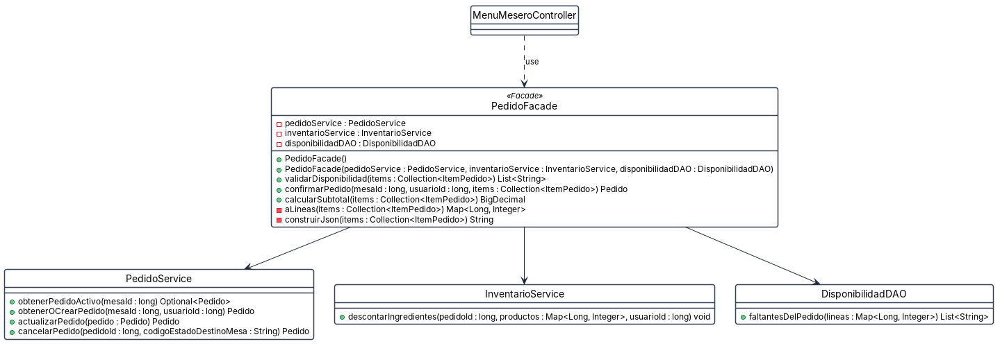

# Patrón Facade · HU #293 · la confirmación de un pedido

**Por qué está.** Confirmar un pedido no es una operación sino varias y en orden, contra dos servicios y un DAO, con una bandera de idempotencia y una compensación si algo falla. Todo eso vivía en la pantalla del mesero. Esta vista responde qué quedó escondido detrás de la fachada.

**Qué muestra.** Son 5 cajas y 4 flechas, con 3 atributos y 13 operaciones. De las tres clases del subsistema no se dibujan todos sus métodos, solo los que la fachada les llama: cuatro de PedidoService, uno de InventarioService y uno de DisponibilidadDAO. Eso es justo lo que hace una fachada, estrechar la superficie. Las tres flechas que bajan son de asociación y no de uso suelto, porque los tres son atributos suyos declarados en el constructor. Conviene saber que la fachada cubre confirmar, validar y calcular el subtotal, pero no todo el subsistema: para obtener el pedido activo o cancelarlo, la pantalla sigue hablando directamente con PedidoService.
