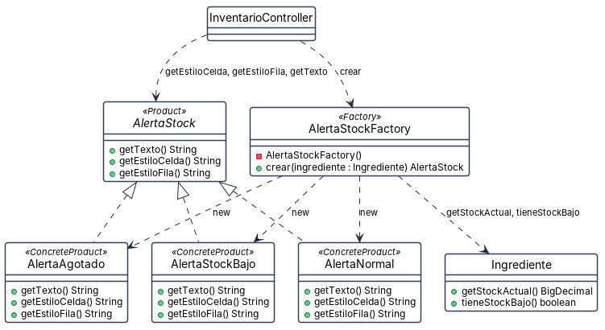

# Patrón Factory · las alertas de stock del inventario

**Por qué está.** La pantalla de inventario decidía en tres sitios distintos el texto de la columna de alerta y los dos estilos, comparando cantidades a mano cada vez. Esta vista responde quién decide ahora qué alerta corresponde a un ingrediente.

**Qué muestra.** Son 7 cajas y 9 flechas, 3 de ellas de realización, con 16 operaciones. Las tres flechas new que salen del creador son la decisión del patrón, y la que va a Ingrediente muestra en qué se basa para tomarla. InventarioController queda a un lado pidiendo por crear y consumiendo por la interfaz, sin nombrar nunca una clase concreta. Hay que decir una cosa: este creador es un método estático con constructor privado, lo que se conoce como Simple Factory y no figura en el catálogo de los 23 patrones GoF, que recoge Factory Method y Abstract Factory.
